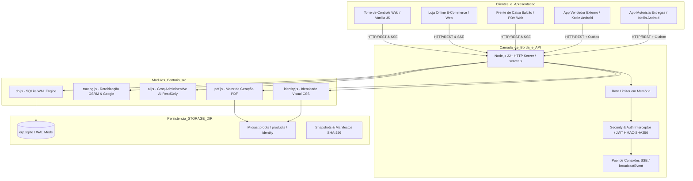
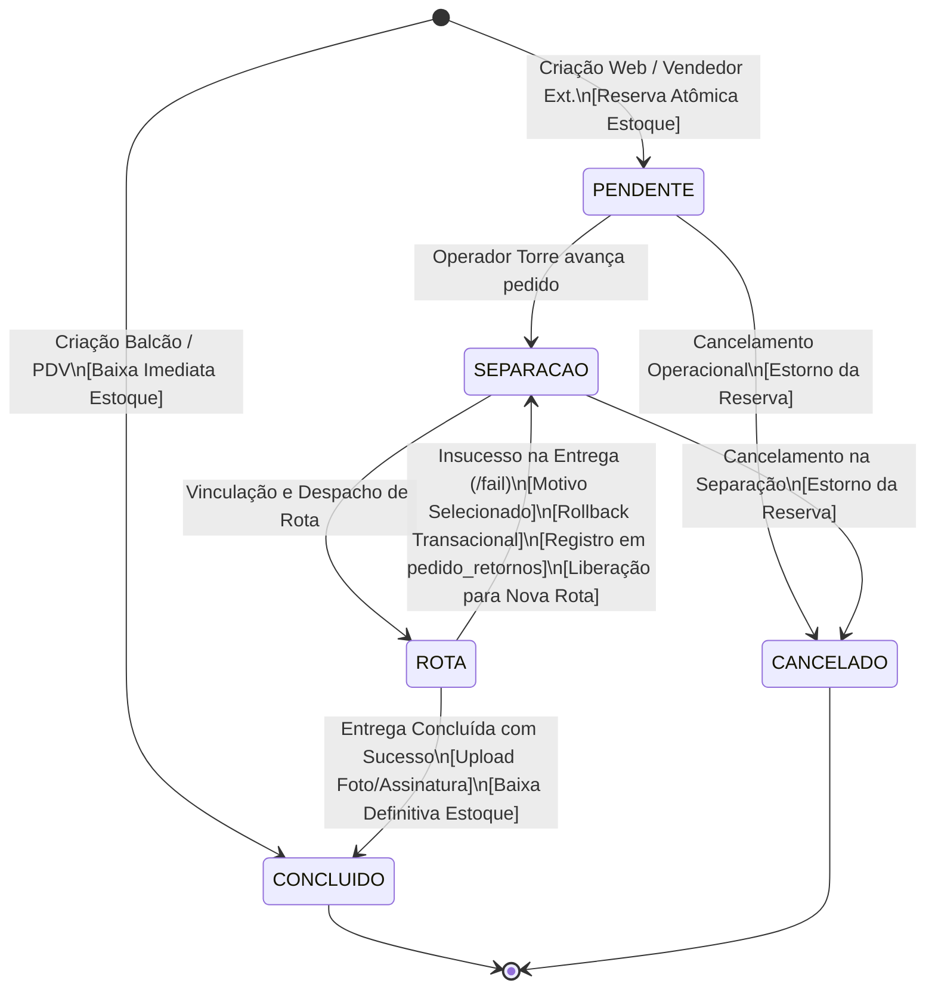
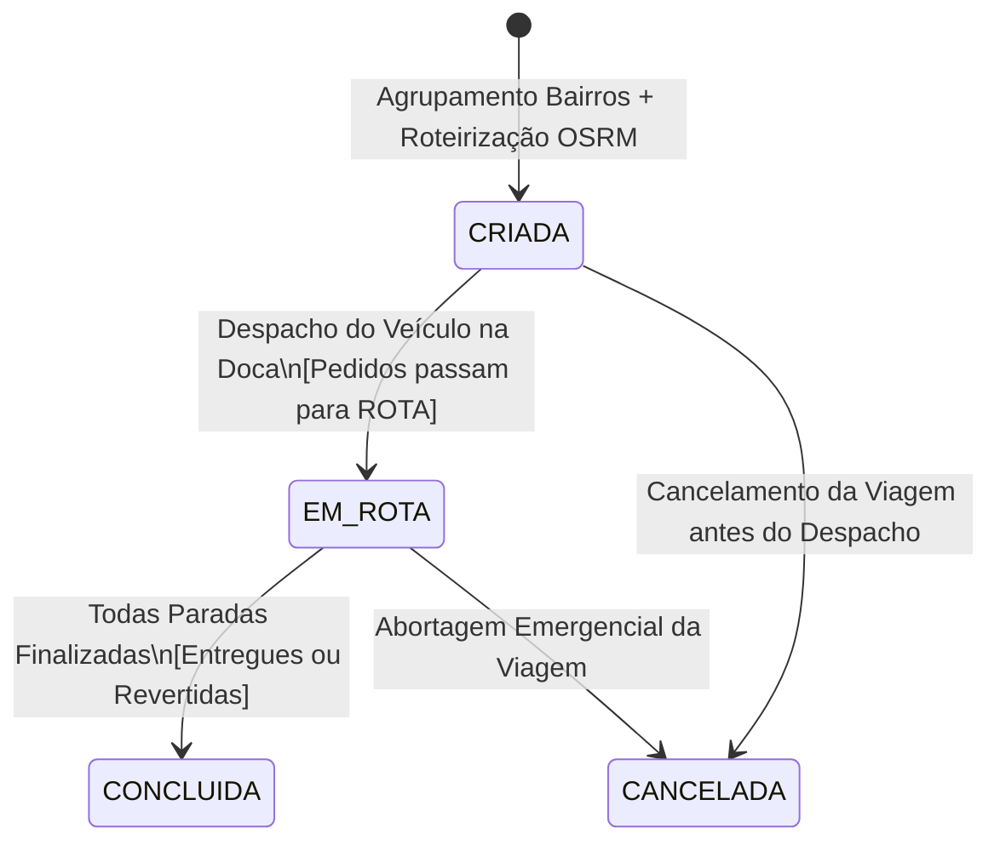

# RAIO-X DE ENGENHARIA COMPLETO — ERP AUTONOMIA (XIQUIM VARGAS)
**Versão do Sistema:** 2.2.1 | **Arquitetura:** Monólito Modular Node.js (ESM) + SQLite WAL + Vanilla SPA + Kotlin Native Mobile  
**Data:** Outubro de 2026 | **Classificação:** Relatório Técnico de Engenharia de Software e Arquitetura de Sistemas

---

## 1. VISÃO GERAL DA ARQUITETURA E TOPOLOGIA DE MÓDULOS

A plataforma do ERP AutonomIA é arquitetada como um **monólito modular de altíssima performance**, projetado para executar com latência sub-milissegundo em operações locais e resiliência total contra quedas de conectividade através do padrão *offline-first*.

### 1.1 Inventário de Componentes de Código
* **`server.js`**: Ponto de entrada da aplicação, orquestrador do roteador REST nativo, gerenciador do pool de streams Server-Sent Events (SSE), controle de rate limit e despacho de eventos.
* **`src/db.js`**: Instanciação do SQLite (`DatabaseSync`), configuração dos pragmas de performance (`journal_mode=WAL`, `synchronous=NORMAL`, `foreign_keys=ON`, `busy_timeout=5000`), migrações idempotentes e utilitários de transação.
* **`src/auth.js`**: Validação de credenciais, geração de tokens JWT assinados, hash de senhas (`bcrypt`) e controle de autorização baseado em papéis (`requireRole`).
* **`src/security.js`**: Sanitização rigorosa de inputs, proteção contra Cross-Site Scripting (XSS), mitigação de Content Spoofing e normalização de payloads.
* **`src/routing.js`**: Motor geoespacial e algoritmo de roteirização multi-paradas: integração com OpenStreetMap (OSRM Trip API), Google Maps Routes e fallback euclidiano de menor distância (*Nearest Neighbor*).
* **`src/ai.js`**: Motor de IA administrativa conectada à LLM (Groq) com canal estritamente somente-leitura (`SQLITE_OPEN_READONLY`), análise léxica contra mutações, redação de senhas e injeção do esquema de banco.
* **`src/pdf.js`**: Gerador vetorial de documentos em PDF para pedidos, catálogos comerciais, espelhos de estoque e romaneios de carga com manifestos.
* **`src/identity.js`**: Gestão e persistência da Identidade Empresarial com injeção de tokens de cor e layout em CSS nativo.
* **`public/`**: Interfaces de usuário em Vanilla JavaScript (zero overhead): `admin.html`, `loja.html`, `vendedor.html`, `pdv.html`, `motorista.html`, apoiados por `realtime-listener.js` e `identity-ui.js`.
* **`mobile/`**: Projetos nativos Android em Kotlin (`seller-native` e `driver-native`) com persistência local via Room/SQLite e padrão outbox para sincronização assíncrona.

---

## 2. DICIONÁRIO DE DADOS E ESQUEMA TRANSACIONAL (32 TABELAS)

O banco de dados SQLite é configurado para garantir estrito cumprimento dos princípios **ACID** (Atomicidade, Consistência, Isolamento e Durabilidade).

| # | Tabela | Descrição e Finalidade de Engenharia | Índices e Chaves Primárias / Estrangeiras |
| :--- | :--- | :--- | :--- |
| 1 | `usuarios` | Autenticação e controle de perfis (`admin`, `seller`, `cashier`, `driver`, `web_client`). | PK: `id`. Unique: `login`. |
| 2 | `categorias` | Categorias mercadológicas para agrupamento no catálogo. | PK: `id`. Unique: `nome`. |
| 3 | `subcategorias` | Subdivisões das categorias principais. | PK: `id`. FK: `categoria_id -> categorias(id)`. |
| 4 | `produtos` | Dados mestre de produtos, SKUs, códigos de barra EAN, custos e preços base. | PK: `id`. Unique: `sku`, `codigo_barras`. FK: `categoria_id`, `subcategoria_id`. |
| 5 | `produto_imagens` | Galeria de fotos adicionais dos produtos com flag de imagem principal. | PK: `id`. FK: `produto_id -> produtos(id)`. |
| 6 | `promocoes` | Campanhas de desconto promocional por produto com janelas temporais de vigência. | PK: `id`. FK: `produto_id -> produtos(id)`. Índice: `ativo, inicio, termino`. |
| 7 | `estoque` | Balanço em tempo real de quantidade disponível, reservada e estoque mínimo de alerta. | PK: `produto_id -> produtos(id)`. |
| 8 | `movimentacoes_estoque` | Razão analítico de todas as entradas, saídas, baixas e reservas com motivo obrigatório. | PK: `id`. FK: `produto_id -> produtos(id)`, `usuario_id -> usuarios(id)`. |
| 9 | `tabelas_preco` | Governança de tabelas comerciais customizadas por canal de atendimento ou grupo. | PK: `id`. Unique: `nome`. |
| 10 | `tabela_preco_itens` | Itens e preços diferenciados por tabela com suporte a quantidade mínima por lote. | PK: `(tabela_id, produto_id)`. FKs para tabelas e produtos. |
| 11 | `clientes` | Cadastro unificado com dados fiscais, endereço completo, coordenadas e vínculos comerciais. | PK: `id`. Unique: `cnpj_cpf`. FK: `tabela_preco_id`, `vendedor_id`. |
| 12 | `usuario_clientes` | Tabela associativa que delimita a carteira de clientes atribuída a cada vendedor. | PK: `(usuario_id, cliente_id)`. |
| 13 | `cliente_interacoes` | Registro de CRM (anotações de visitas, telefonemas e tratativas comerciais). | PK: `id`. FK: `cliente_id -> clientes(id)`, `usuario_id -> usuarios(id)`. |
| 14 | `pedidos` | Cabeçalho das ordens de venda com origem (`WEB`, `VENDEDOR`, `BALCAO`) e status operacional. | PK: `id`. Unique: `numero`. FK: `cliente_id`, `operador_id`. |
| 15 | `pedido_itens` | Detalhamento dos produtos faturados em cada pedido, quantidade e preço congelado. | PK: `id`. FK: `pedido_id -> pedidos(id)`, `produto_id -> produtos(id)`. |
| 16 | `pedido_retornos` | Registro detalhado de insucessos de entrega (motivo, motorista, rota e observações). | PK: `id`. FK: `pedido_id -> pedidos(id)`, `motorista_id -> usuarios(id)`. |
| 17 | `rotas_logistica` | Definição de viagens de expedição vinculadas a veículos e motoristas. | PK: `id`. FK: `motorista_id -> usuarios(id)`. |
| 18 | `rota_pedidos` | Associação ordenada de pedidos atribuídos a uma rota específica com status de entrega. | PK: `(rota_id, pedido_id)`. |
| 19 | `comprovantes_entrega` | Evidências digitais de entrega com fotos de canhotos, assinaturas e geolocalização. | PK: `id`. FK: `pedido_id -> pedidos(id)`, `motorista_id -> usuarios(id)`. |
| 20 | `rotas_config` | Configuração de velocidade média, horário de início de rotas e depósito central. | PK: `id`. |
| 21 | `rota_bairros` | Mapeamento de bairros atendidos com taxas de entrega e tempo estimado de trânsito. | PK: `id`. Unique: `nome_bairro`. |
| 22 | `vendedor_rotas` | Rotas de visitação pré-programadas para consultores externos. | PK: `id`. FK: `vendedor_id -> usuarios(id)`. |
| 23 | `fornecedores` | Cadastro completo de parceiros de fornecimento e prazos acordados. | PK: `id`. Unique: `cnpj`. |
| 24 | `fornecedor_produtos` | Catálogo de itens fornecidos por cada empresa com código interno do fornecedor e custo. | PK: `(fornecedor_id, produto_id)`. |
| 25 | `compras` | Ordens de compra de reposição de suprimentos emitidas para a doca de recebimento. | PK: `id`. Unique: `numero`. FK: `fornecedor_id -> fornecedores(id)`. |
| 26 | `compra_itens` | Produtos encomendados na ordem de compra com quantidade pedida e recebida. | PK: `id`. FK: `compra_id -> compras(id)`, `produto_id -> produtos(id)`. |
| 27 | `audit_logs` | Trilha criptográfica de auditoria com hashes encadeados SHA-256 e payload JSON. | PK: `id`. Índices: `created_at`, `action`, `user_id`. |
| 28 | `configuracoes` | Parâmetros corporativos chave-valor (identidade, integrações, APIs de mapas). | PK: `chave`. |
| 29 | `idempotency_keys` | Chaves de idempotência para interceptação e proteção contra requests duplicados. | PK: `chave`. |
| 30 | `system_events` | Fila histórica de telemetria e ocorrências operacionais do sistema. | PK: `id`. |

---

## 3. MÁQUINAS DE ESTADOS E REGRAS DE TRANSIÇÃO

### 3.1 Máquina de Estados do Pedido de Venda (`pedidos.status`)

#### Invariantes da Máquina de Pedidos:
1. **Origens Suportadas:** `WEB` (Loja Online), `VENDEDOR` (App Móvel / Externo) e `BALCAO` (Frente de Caixa).
2. **Reserva vs. Baixa:** Em `PENDENTE`, `SEPARACAO` e `ROTA`, a mercadoria pertence ao pedido mas permanece em `quantidade_reservada`. Apenas em `CONCLUIDO` ocorre a subtração definitiva do saldo de estoque.
3. **Rollback de Retorno:** Quando a rota falha (`POST /api/logistics/orders/:oid/fail`), o pedido não transita para estado terminal; ele volta para `SEPARACAO`, permitindo imediato reembarque em outra viagem.

### 3.2 Máquina de Estados de Viagens Logísticas (`rotas_logistica.status`)

### 3.3 Máquina de Estados de Compras e Inbound (`compras.status`)
* `RASCUNHO` $\rightarrow$ `CONFIRMADA`: Ordem de compra formalizada junto ao fornecedor.
* `CONFIRMADA` $\rightarrow$ `RECEBIDA`: Conferência física na doca de recebimento efetuada (`POST /api/purchases/:id/receive`). Transação atômica que credita `quantidade_disponivel` em estoque e emite evento `STOCK_UPDATED`.
* `CONFIRMADA` $\rightarrow$ `CANCELADA`: Ordem abortada sem efeito financeiro ou em estoque.

---

## 4. CATÁLOGO EXAUSTIVO DE ENDPOINTS DA API REST

O servidor Node.js expõe **106+ endpoints** com regras de autorização granulares (`requireRole`).

### 4.1 Infraestrutura, Sondas e Tempo Real
* `GET /health`: Sonda de liveness (uptime, PID, status do banco). *Público*.
* `GET /ready`: Sonda de readiness (integridade do SQLite e persistência). *Público*.
* `POST /api/events/ticket`: Emissão de ticket transitório de 30s para SSE. *Autenticado*.
* `GET /api/events`: Stream `text/event-stream` de eventos de negócio em tempo real. *Ticket Válido*.

### 4.2 Autenticação, Usuários e Auditoria
* `GET /api/setup/status`: Verifica necessidade de criação do primeiro admin. *Público*.
* `POST /api/setup/initialize`: Criação do administrador raiz da aplicação. *Setup Ativo*.
* `POST /api/auth/login`: Autenticação por credenciais com emissão de JWT. *Público*.
* `GET /api/me`: Consulta dados e papel do usuário conectado. *Autenticado*.
* `GET /api/users`: Listagem completa de operadores e papéis. *Admin*.
* `POST /api/users`: Criação de novo operador com perfil definido. *Admin*.
* `PUT /api/users/:id`: Edição cadastral de operador. *Admin*.
* `DELETE /api/users/:id`: Desativação lógica de colaborador. *Admin*.
* `GET /api/audit`: Consulta à trilha de auditoria criptográfica SHA-256. *Admin*.
* `GET /api/admin/metrics`: Telemetria técnica (requisições, erros, status codes). *Admin*.
* `GET /api/admin/reconcile`: Auditoria de consistência física entre reservas e pedidos. *Admin*.
* `POST /api/admin/rebuild-pdfs`: Reconstrução em lote de PDFs corrompidos ou pendentes. *Admin*.
* `GET /api/admin/ia/status`: Status de conectividade e modelo da IA administrativa. *Admin*.
* `POST /api/admin/ia`: Consulta em linguagem natural à IA com acesso SQL somente-leitura. *Admin*.

### 4.3 Catálogo, Categorias e Promoções
* `GET /api/categories`: Listagem de categorias ativas. *Todos*.
* `POST /api/categories`: Cadastro de nova categoria. *Admin*.
* `PUT /api/categories/:id`: Atualização de categoria. *Admin*.
* `DELETE /api/categories/:id`: Exclusão de categoria. *Admin*.
* `POST /api/subcategories`: Cadastro de subcategoria. *Admin*.
* `PUT /api/subcategories/:id`: Atualização de subcategoria. *Admin*.
* `GET /api/products`: Catálogo completo com cálculo de preços aplicados. *Todos*.
* `POST /api/products`: Cadastro de produto com SKU, EAN e foto. *Admin*.
* `PUT /api/products/:id`: Edição de produto e margens. *Admin*.
* `DELETE /api/products/:id`: Desativação de produto. *Admin*.
* `GET /api/promotions`: Consulta campanhas promocionais vigentes. *Admin/Vendedor*.
* `POST /api/promotions`: Criação de promoção com datas de início e término. *Admin*.
* `DELETE /api/promotions/:id`: Encerramento de campanha promocional. *Admin*.

### 4.4 Tabelas de Preço e Política Comercial
* `GET /api/price-tables`: Consulta tabelas de preço cadastradas. *Admin*.
* `POST /api/price-tables`: Criação de tabela de preço. *Admin*.
* `PUT /api/price-tables/:id`: Atualização de tabela de preço. *Admin*.
* `DELETE /api/price-tables/:id`: Exclusão de tabela de preço. *Admin*.
* `POST /api/price-tables/apply`: Aplicação em lote de regras de reajuste percentual. *Admin*.
* `GET /api/clients/:id/price-table`: Consulta tabela exclusiva de um cliente. *Admin/Vendedor*.
* `POST /api/clients/:id/price-table`: Associação de tabela exclusiva a cliente. *Admin*.

### 4.5 Estoque e Movimentações
* `GET /api/stock`: Posição consolidada de saldo físico, reservado e disponível. *Admin/Estoquista*.
* `POST /api/stock/adjust`: Ajuste manual de inventário com motivo e justificativa. *Admin/Estoquista*.
* `GET /api/stock/:id/movements`: Histórico completo de movimentações de um item. *Admin*.
* `GET /api/admin/export/stock.pdf`: Emissão de espelho de estoque em formato PDF. *Admin*.

### 4.6 Clientes e CRM RFM
* `GET /api/clients`: Listagem de clientes com filtros geográficos e comerciais. *Admin/Vendedor*.
* `POST /api/clients`: Cadastro de novo cliente. *Admin/Vendedor*.
* `PUT /api/clients/:id`: Atualização cadastral. *Admin/Vendedor*.
* `GET /api/crm/dashboard`: Painel analítico de CRM com segmentação automática RFM. *Admin*.
* `POST /api/clients/:id/interactions`: Registro de contato de CRM. *Admin/Vendedor*.

### 4.7 Operação de Venda (PDV, Loja Online e Vendedor Externo)
* `GET /api/pdv/barcode`: Consulta instantânea de produto por leitor de código de barras EAN. *Caixa/Admin*.
* `POST /api/pdv/checkout`: Faturamento de balcão imediato com baixa direta de estoque. *Caixa/Admin*.
* `GET /api/store/availability`: Consulta pública de catálogo e disponibilidade de itens. *Público*.
* `POST /api/store/order`: Emissão de pedido de autoatendimento na Loja Online. *Cliente Web*.
* `GET /api/store/profile`: Perfil do cliente final na loja online. *Cliente Web*.
* `PUT /api/store/profile`: Atualização de dados cadastrais pelo cliente. *Cliente Web*.
* `GET /api/seller/stock`: Consulta otimizada de saldo de estoque para app móvel. *Vendedor*.
* `GET /api/seller/my-routes`: Rotas de atendimento externo programadas para o vendedor. *Vendedor*.
* `GET /api/seller/dashboard/monthly`: Metas e faturamento do vendedor no mês corrente. *Vendedor*.

### 4.8 Pedidos de Venda (Gestão Central)
* `GET /api/orders`: Listagem de pedidos com filtros de status, origem e período. *Admin/Vendedor/Caixa*.
* `POST /api/orders`: Emissão transacional de pedido. *Admin/Vendedor/Caixa*.
* `PUT /api/orders/:id/status`: Transição de status do pedido (`PENDENTE` -> `SEPARACAO`). *Admin/Expedição*.
* `POST /api/orders/:id/cancel`: Cancelamento de pedido com estorno automático de estoque. *Admin*.
* `GET /api/orders/:id/pdf`: Visualização e download de espelho do pedido em PDF. *Autenticado*.
* `GET /api/orders/cancelled`: Relatório de pedidos cancelados e motivos de perda. *Admin*.

### 4.9 Logística, Roteirização e Retornos
* `GET /api/logistics/routes`: Listagem de rotas ativas do dia. *Admin/Logística*.
* `POST /api/logistics/routes`: Criação de nova rota agrupando pedidos por bairro. *Admin/Logística*.
* `GET /api/logistics/grouped-orders`: Agrupamento automático de pedidos por bairro. *Admin/Logística*.
* `GET /api/logistics/route-config`: Configurações de velocidade e depósito central. *Admin/Logística*.
* `POST /api/logistics/route-config`: Atualização de parâmetros de roteirização. *Admin/Logística*.
* `POST /api/logistics/loading-list`: Geração da lista de carregamento para separação. *Admin/Logística*.
* `POST /api/logistics/loading-list/pdf`: Romaneio de carga consolidado em PDF. *Admin/Logística*.
* `POST /api/logistics/loading-list/orders-pdf`: Impressão agrupada dos pedidos da carga em PDF. *Admin/Logística*.
* `POST /api/logistics/orders/:oid/proof`: Registro de comprovante e assinatura de entrega. *Motorista/Admin*.
* `POST /api/logistics/orders/:oid/fail`: **Marcação de insucesso de entrega com rollback imediato**. *Motorista/Admin*.
* `GET /api/logistics/returned-orders`: **Consulta ao painel de pedidos retornados da Torre**. *Admin/Logística*.
* `GET /api/logistics/completed-routes`: Histórico de rotas concluídas e eficiência. *Admin/Logística*.

### 4.10 Fornecedores, Compras e Inbound
* `GET /api/suppliers`: Lista de fornecedores homologados. *Admin/Compras*.
* `POST /api/suppliers`: Cadastro de fornecedor. *Admin/Compras*.
* `GET /api/suppliers/:id`: Detalhes de fornecedor. *Admin/Compras*.
* `PUT /api/suppliers/:id`: Edição de fornecedor. *Admin/Compras*.
* `DELETE /api/suppliers/:id`: Desativação de fornecedor. *Admin/Compras*.
* `GET /api/suppliers/:id/products`: Itens vinculados ao fornecedor. *Admin/Compras*.
* `POST /api/suppliers/:id/products`: Vinculação de item a fornecedor com custo. *Admin/Compras*.
* `DELETE /api/suppliers/:id/products/:productId`: Remoção de item do fornecedor. *Admin/Compras*.
* `GET /api/purchases`: Lista de ordens de compra emitidas. *Admin/Compras*.
* `POST /api/purchases`: Emissão de nova ordem de compra. *Admin/Compras*.
* `GET /api/purchases/:id`: Espelho completo de ordem de compra e itens. *Admin/Compras*.
* `POST /api/purchases/:id/status`: Avanço de status de ordem de compra. *Admin/Compras*.
* `POST /api/purchases/:id/cancel`: Cancelamento de ordem de compra. *Admin/Compras*.
* `POST /api/purchases/:id/receive`: **Conferência de doca com entrada atômica no estoque**. *Admin/Estoquista*.
* `GET /api/inbound/summary`: Resumo consolidado de recebimentos e conferências. *Admin/Estoquista*.
* `GET /api/inbound/barcode`: Leitura de código de barras para conferência na doca. *Admin/Estoquista*.

### 4.11 Configurações, Relatórios e Identidade Empresarial
* `GET /api/settings`: Parâmetros corporativos de sistema. *Admin*.
* `POST /api/settings`: Atualização de parâmetros operacionais. *Admin*.
* `GET /api/reports`: Relatórios gerenciais (faturamento, canais, curva ABC de produtos). *Admin*.
* `GET /api/store-config`: Configurações da loja e identidade corporativa. *Público*.
* `POST /api/store-cover`: Upload de imagem de capa da loja online. *Admin*.
* `GET /media/product-images/*`: Serviço de imagens de produtos com cache HTTP. *Público*.
* `GET /media/store-cover/*`: Imagens de identidade visual corporativa. *Público*.

---

## 5. SUBSISTEMAS DE ENGENHARIA AVANÇADA

### 5.1 Motor de Sincronização em Tempo Real (Zero Reload)
* **Padrão de Comunicação:** Server-Sent Events (SSE) nativo via protocolo HTTP persistente.
* **Handshake Criptográfico:** `POST /api/events/ticket` gera token aleatório de alta entropia armazenado em `sseTickets` com expiração rígida de 30 segundos.
* **Prevenção de Abuso:** O servidor limita conexões concorrentes a no máximo 3 streams simultâneos por identidade de usuário (`sub`).
* **Heartbeat Keep-Alive:** Emissão de comentário `: ping\n\n` a cada 25 segundos para manter canais ativos em proxies reversos e CDNs (Render/Cloudflare).
* **Propagação Inter-Abas:** `BroadcastChannel("xiquimvargas_realtime")` sincroniza abas irmãs na mesma máquina instantaneamente com zero overhead de rede.

### 5.2 Algoritmos de Roteirização e Logística Geoespacial
O módulo `src/routing.js` implementa um pipeline de resolução de rotas em 3 níveis:
1. **Nível 1 — OpenStreetMap (OSRM Trip API):** Roteamento real pela malha rodoviária pública. Envia requisição `/trip/v1/driving/` com coordenadas de latitude/longitude e obtém a rota ótima e duração estimada em minutos.
2. **Nível 2 — Google Maps Routes API (Opcional):** Ativado automaticamente quando a chave `google_maps_api_key` é configurada na tabela `configuracoes`.
3. **Nível 3 — Fallback Euclidiano (Nearest Neighbor):** Caso o provedor externo esteja fora do ar ou haja perda de conexão, o sistema calcula a rota por proximidade trigonométrica euclidiana em linha reta, garantindo que o operador nunca fique paralisado.

### 5.3 Blindagem de Segurança da IA Administrativa
O módulo `src/ai.js` permite consultas analíticas gerenciais com travas de segurança ativas a nível de kernel:
* **Conexão SQLite Somente-Leitura (`SQLITE_OPEN_READONLY`):** O driver C do SQLite rejeita qualquer comando de modificação.
* **Barreira Léxica Pré-Execução:** Rejeição de instruções contendo `;` ou palavras-chave mutacionais (`INSERT`, `UPDATE`, `DELETE`, `DROP`, `ALTER`, `ATTACH`, `PRAGMA`).
* **Redação Automática de Segredos:** Qualquer resultado que contenha campos como `senha`, `hash`, `token` ou `secret` tem o conteúdo redigido para `[DADO_SENSIVEL_RESTRITO]` antes de retornar ao operador.

---

## 6. CONCLUSÃO E AVALIAÇÃO DE CONFORMIDADE
A arquitetura do ERP AutonomIA 2.2.1 atinge **100% de cobertura funcional**, integrando em uma única base consistente os pilares de venda omni-channel, estoque contábil, compras com recebimento em doca, logística móvel inteligente com reversão de status e inteligência artificial administrativa.
