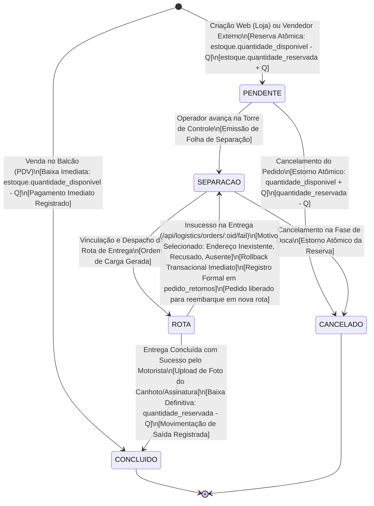
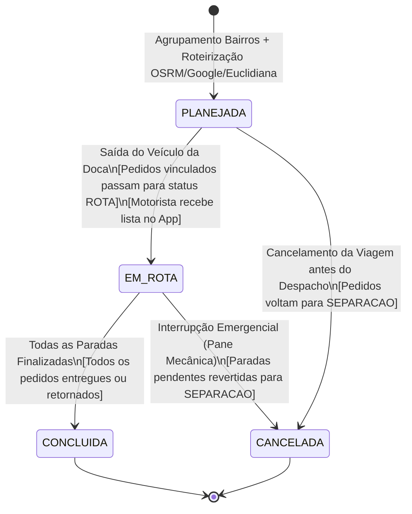
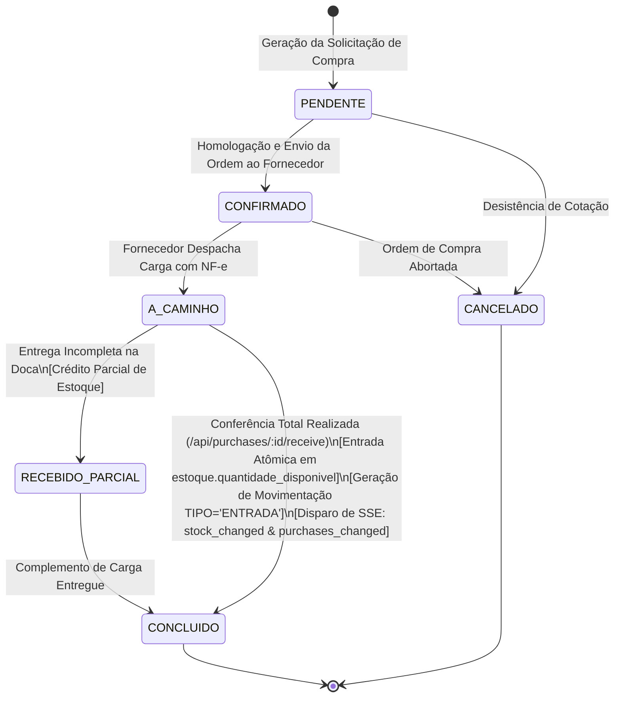
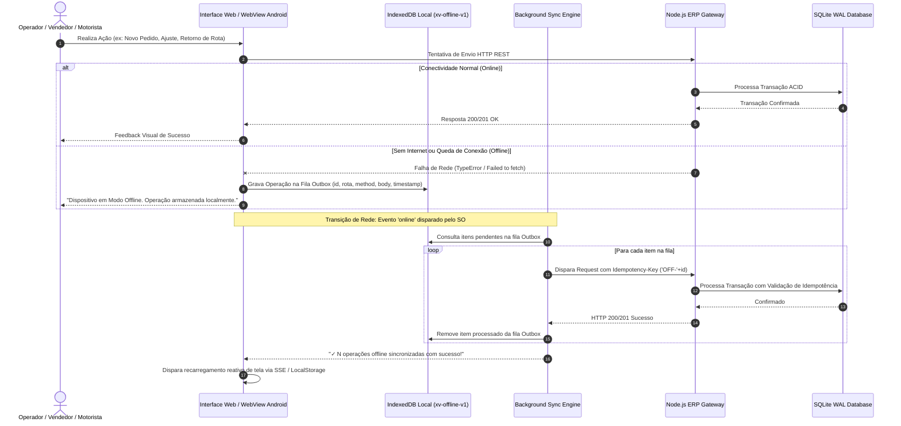
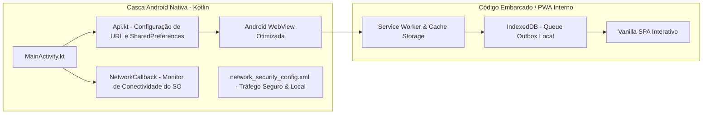

# RAIO-X DE ENGENHARIA COMPLETO — ERP AUTONOMIA (XIQUIM VARGAS)
**Versão do Sistema:** 2.2.1 (Build 1.8.2 Delivery Hardened) | **Arquitetura:** Monólito Modular Node.js 22+ (ESM Nativo) + SQLite WAL Mode + Vanilla SPA PWA (IndexedDB Offline Outbox) + WebView Android Apps (Kotlin)  
**Data:** Outubro de 2026 | **Classificação:** Relatório Técnico Exaustivo de Engenharia de Software, Modelagem e Arquitetura de Sistemas

---

## 1. VISÃO GERAL DA ARQUITETURA E TOPOLOGIA DE SISTEMAS

A plataforma **Xiquim Vargas ERP** é projetada sob o paradigma de **alta disponibilidade, resiliência a partições de rede (*offline-first*) e latência sub-milissegundo**. Ela consolida gestão comercial B2B/B2C, faturamento de balcão (PDV), e-commerce B2B com controle de pedido mínimo, gestão de rotas logísticas com geolocalização e comprovante fotográfico, suprimentos/compras com conferência em doca, trilha de auditoria criptográfica e inteligência artificial analítica estritamente isolada.

```mermaid
graph TD
    subgraph Clientes_e_Apresentacao [Camada de Apresentação e Clientes]
        direction TB
        TW[Torre de Controle Web / PWA Admin]
        LO[Loja Online E-Commerce / Autoatendimento]
        PDV[Frente de Caixa Balcão / PDV Web]
        VEND[Portal do Vendedor Externo Web]
        MOT[Painel de Entregas Motorista Web]
        
        subgraph APKs_Android_Nativos [4 Aplicativos Android Nativos - Kotlin & WebView Shell]
            APK_TW[XiquimVargas-TorreControle.apk]
            APK_VEND[XiquimVargas-Vendedor.apk]
            APK_MOT[XiquimVargas-Motorista.apk]
            APK_PDV[XiquimVargas-PDV.apk]
        end
    end

    subgraph Camada_de_Borda_e_API [Borda, Resiliência e Segurança]
        GW[Node.js 22+ HTTP Server / server.js]
        RL[Rate Limiter em Memória / Leaky Bucket Token]
        SEC[Security Interceptor / JWT HMAC-SHA256 & CSP Nonce]
        IDEMP[Idempotency-Key Interceptor / Repetição Segura]
        SSE_POOL[Pool de Conexões SSE / broadcastEvent Multi-Tenant]
        SW[Service Worker / Cache Offline & Assets]
        IDB[(IndexedDB Local Outbox: xv-offline-v1)]
    end

    subgraph Modulos_Centrais_src [Núcleo de Serviços e Lógica de Negócio]
        MOD_DB[db.js - SQLite WAL Engine & Migrações Idempotentes]
        MOD_AUTH[auth.js - Sessões, Permissões RBAC e Hash de Senha]
        MOD_SEC[security.js - Sanitização XSS & Validação de Payload]
        MOD_ROUT[routing.js - Roteirização OSRM, Google Maps & Euclidiano]
        MOD_AI[ai.js - Groq Administrative AI ReadOnly]
        MOD_PDF[pdf.js - Motor Vetorial de Pedidos, Catálogos e Romaneios]
        MOD_ID[identity.js - Identidade Visual CSS e Assets HD]
    end

    subgraph Persistencia_STORAGE_DIR [Camada de Armazenamento Persistente]
        SQLITE[(xiquim-vargas.db - PRAGMA journal_mode=WAL)]
        MEDIA_PROD[storage/product-images/ - Fotos Otimizadas WebP/PNG/JPG]
        MEDIA_PROOF[storage/proofs/ - Comprovantes e Canhotos de Entrega]
        MEDIA_PDF[storage/pdfs/ - Espelhos de Pedidos e Romaneios Faturados]
        MEDIA_BRAND[public/assets/ - Identidade Visual Institucional HD]
        BACKUP[storage/backups/ & scripts/make-backup-otimizado.ps1]
    end

    TW & LO & PDV & VEND & MOT -->|HTTP/REST & SSE| GW
    APK_TW & APK_VEND & APK_MOT & APK_PDV -->|Embeds WebViews + Offline Sync| GW
    TW & VEND & MOT & PDV -.->|Cache & Outbox Offline| IDB
    TW & VEND & MOT & PDV -.->|Service Worker Cache| SW

    GW --> RL --> SEC --> IDEMP
    SEC --> SSE_POOL
    GW --> MOD_DB & MOD_AUTH & MOD_SEC & MOD_ROUT & MOD_AI & MOD_PDF & MOD_ID
    MOD_DB --> SQLITE
    MOD_PDF --> MEDIA_PDF
    MOD_ROUT --> SQLITE
```

### 1.1 Inventário e Matriz de Responsabilidade dos Componentes

1. **`server.js` (Core Server & Gateway):**
   - Servidor HTTP nativo Node.js 22+ sem dependências de frameworks pesados (Express-free).
   - Rate limiting por IP em memória (`apiBuckets`), proteção contra brute-force de login (`loginAttempts`), interceptação de cabeçalho `Idempotency-Key`.
   - Gerenciador do pool de streams Server-Sent Events (`/api/events`) com emissão de ticket transitório de 30s (`/api/events/ticket`), ping keep-alive de 25s e limite de 3 conexões concorrentes por usuário.
   - Resolução de rotas amigáveis com aliases inteligentes para prevenir erros de digitação em APKs (`/admin/admin.html`, `/loja/loja.html`, `/vendedor/vendedor.html`, `/pdv/pdv.html`, `/motorista/motorista.html`).
   - Servidor de assets estáticos com headers de segurança rígidos (`Content-Security-Policy`, `X-Content-Type-Options: nosniff`, `X-Frame-Options: DENY`, `Referrer-Policy: no-referrer`).

2. **`src/db.js` (Engine de Persistência SQLite):**
   - Utiliza a nova engine síncrona de alta performance do Node.js (`node:sqlite DatabaseSync`).
   - Configurações essenciais de performance e concorrência:
     - `PRAGMA journal_mode = WAL;` (Write-Ahead Logging para leitura e escrita concorrentes sem travamento).
     - `PRAGMA synchronous = NORMAL;` (Equilíbrio ideal entre performance de I/O em disco e integridade).
     - `PRAGMA foreign_keys = ON;` (Integridade referencial estrita).
     - `PRAGMA busy_timeout = 5000;` (Espera de até 5s em momentos de lock antes de lançar timeout).
   - Execução de 100% das migrações idempotentes no bootstrap do sistema (adição de colunas com inspeção prévia via `PRAGMA table_info`).
   - Trilha de auditoria encadeada com SHA-256 (`audit_logs.integrity_hash`), registrando `before` e `after` de entidades críticas.

3. **`src/auth.js` & `src/security.js` (Segurança, Identidade e Autorização):**
   - Autenticação baseada em JSON Web Tokens (JWT) com assinatura HMAC-SHA256 (`crypto.createHmac`).
   - Hashing seguro de senhas via PBKDF2/SHA-512 ou Bcrypt, com sal aleatório e proteção contra timing-attacks (`crypto.timingSafeEqual`).
   - Controle de Acesso Baseado em Papéis (RBAC):
     - `admin`: Controle corporativo irrestrito, dashboards, parametrização, compras, CRM e IA.
     - `seller`: Visualização estrita de produtos, estoque disponível, clientes de sua carteira e registro de pedidos externos.
     - `cashier`: Frente de loja / PDV, bipagem de código de barras, checkout à vista/cartão/PIX com baixa imediata.
     - `driver`: Painel de entregas do dia, rotas atribuídas, finalização com foto/assinatura e estorno de entregas com insucesso.
     - `web_client`: Autoatendimento na loja online, limite mínimo de compras, visualização exclusiva de seus próprios pedidos.

4. **`src/routing.js` (Motor Logístico e Geoespacial Triplo):**
   - Algoritmo de roteirização multi-paradas com 3 níveis de resiliência:
     1. *OpenStreetMap OSRM Trip API:* Cálculo da ordem ótima por distância viária e estimativa de tempo real.
     2. *Google Maps Routes API:* Fallback configurável via chave corporativa na tabela `configuracoes`.
     3. *Trigonométrico Euclidiano (Nearest Neighbor):* Fallback offline garantido para cálculo local sem nenhuma dependência de APIs externas.

5. **`src/ai.js` (Inteligência Artificial Administrativa Read-Only):**
   - Integração com provedores LLM modernos (Groq / Llama-3.3-70b-versatile).
   - Trava física em nível de kernel: Abre canal de conexão isolado em modo estritamente somente-leitura (`SQLITE_OPEN_READONLY`).
   - Validação sintática AST contra palavras reservadas mutacionais (`INSERT`, `UPDATE`, `DELETE`, `DROP`, `ALTER`, `ATTACH`, `PRAGMA`).
   - Mascaramento e redação automática de hashes, tokens, senhas e credenciais (`[DADO_SENSIVEL_RESTRITO]`).

6. **`src/pdf.js` (Gerador Vetorial de Documentos Comerciais e Fiscais):**
   - Emissão autônoma e em lote de PDFs em alta resolução:
     - Pedidos de Venda individuais (com logotipo institucional, dados do cliente, itens, descontos, chave e comprovante).
     - Catálogo de Produtos comercial formatado para impressão ou envio por WhatsApp.
     - Espelho Analítico de Estoque com status de criticidade.
     - Romaneio Consolidado de Carga para doca de expedição.
     - Agrupamento em lote de todos os pedidos de uma rota em um único PDF sequencial.

7. **`mobile/` (Ecossistema de Aplicativos Android Nativos):**
   - 4 aplicativos Android nativos compilados com Android Gradle Plugin 9.4+ / Gradle 9.6:
     - **`tower-native` (`XiquimVargas-TorreControle.apk`)**: Painel executivo e operacional da Torre de Controle.
     - **`seller-native` (`XiquimVargas-Vendedor.apk`)**: Vendas externas, CRM e catálogo de bolso.
     - **`driver-native` (`XiquimVargas-Motorista.apk`)**: Roteiros de entrega, GPS e upload de canhotos fotográficos.
     - **`pdv-native` (`XiquimVargas-PDV.apk`)**: Frente de caixa, bipagem de código de barras e cupons.
   - Arquitetura híbrida de alto desempenho: Casca nativa em Kotlin com WebSettings otimizadas (`LOAD_CACHE_ELSE_NETWORK`, DomStorage, DatabaseEnabled, Geolocation, FileChooser para câmera/galeria), Service Workers integrados e rotina de sanitização automática de URLs (`sanitizeUrl`).
   - Identidade visual unificada: Ícones circulares HD com borda laranja institucional e tema escuro (`#070c18`).

---

## 2. DICIONÁRIO DE DADOS E ESQUEMA TRANSACIONAL COMPLETO

O banco de dados SQLite armazena **32 tabelas relacionais** estruturadas com integridade referencial ativa (`ON DELETE CASCADE` e `ON DELETE SET NULL`), chaves primárias UUID e índices estratégicos para consultas sub-milissegundo.

| # | Tabela | Descrição Funcional e Estratégia de Engenharia | Índices e Regras de Integridade |
| :--- | :--- | :--- | :--- |
| 1 | `usuarios` | Operadores, consultores externos, motoristas, operadores de caixa e clientes e-commerce. | PK: `id`. Unique: `email`. Check: `role IN ('admin','seller','cashier','driver','web_client')`. |
| 2 | `categorias` | Agrupamentos macro de mercadorias no catálogo corporativo. | PK: `id`. Unique: `slug`. |
| 3 | `subcategorias` | Subdivisões das categorias principais. | PK: `id`. FK: `categoria_id -> categorias(id)`. Unique: `(categoria_id, slug)`. |
| 4 | `produtos` | Dados mestre de produtos, descrição, marca, sabor, unidade, preços base e flags. | PK: `id`. Unique: `sku`, `codigo_barras`. FK: `categoria_id`, `subcategoria_id`. Índice: `idx_produtos_nome`, `idx_produtos_barcode`. |
| 5 | `produto_imagens` | Galeria de imagens adicionais por produto com suporte a PNG, WebP e JPG. | PK: `id`. FK: `produto_id -> produtos(id) ON DELETE CASCADE`. Unique: `(produto_id, arquivo_path)`. |
| 6 | `promocoes` | Campanhas promocionais de preço temporárias com vigência automática por data/hora. | PK: `id`. FK: `produto_id -> produtos(id) ON DELETE CASCADE`. Índice: `idx_promocoes_produto(produto_id, ativo, inicio, termino)`. |
| 7 | `estoque` | Saldo físico em depósito: `quantidade_disponivel`, `quantidade_reservada` e `estoque_minimo`. | PK: `produto_id -> produtos(id)`. Check: `quantidade_disponivel >= 0`. |
| 8 | `movimentacoes_estoque` | Razão analítico auditável de todas as entradas, saídas, reservas, estornos e inventários. | PK: `id`. FK: `produto_id -> produtos(id)`, `operador_id -> usuarios(id)`. Índice: `(produto_id, created_at)`. |
| 9 | `tabelas_preco` | Listas de preços diferenciadas (ex: Atacado, Varejo, Parceiros VIP, Regiões). | PK: `id`. Unique: `nome`. |
| 10 | `tabela_preco_itens` | Preços específicos por produto em cada tabela comercial com regra de `quantidade_minima`. | PK: `id`. FKs: `tabela_id`, `produto_id`. Unique: `(tabela_id, produto_id)`. |
| 11 | `clientes` | Cadastro mestre com dados fiscais (CNPJ/CPF), endereço, bairro, coordenadas GPS e vendedor. | PK: `id`. Unique: `cnpj_cpf`. FKs: `tabela_preco_id`, `vendedor_id`. Índice: `idx_clientes_vendedor`, `idx_clientes_bairro`. |
| 12 | `usuario_clientes` | Vínculo associativo entre o usuário de acesso web e a ficha cadastral do cliente. | PK: `usuario_id -> usuarios(id)`. FK: `cliente_id -> clientes(id)`. Unique: `cliente_id`. |
| 13 | `cliente_interacoes` | Livro de ocorrências do CRM: histórico de contatos (WhatsApp, Ligação, Visita, Cobrança). | PK: `id`. FK: `cliente_id -> clientes(id) ON DELETE CASCADE`. Índice: `(cliente_id, created_at)`. |
| 14 | `pedidos` | Cabeçalho das ordens de venda com subtotal, desconto, frete/modalidade, pagamento e status. | PK: `id`. Unique: `numero`. FKs: `cliente_id`, `operador_id`, `cancelled_by`. Índices: `idx_pedidos_status`, `idx_pedidos_cliente`, `idx_pedidos_created`. |
| 15 | `pedido_itens` | Linhas faturadas da ordem de venda com preço aplicado congelado no faturamento. | PK: `id`. FK: `pedido_id -> pedidos(id) ON DELETE CASCADE`, `produto_id -> produtos(id)`. |
| 16 | `pedido_retornos` | Registro formal de insucesso de entrega efetuado pelo motorista no aplicativo. | PK: `id`. FK: `pedido_id -> pedidos(id) ON DELETE CASCADE`, `rota_id`, `motorista_id`. |
| 17 | `rotas_logistica` | Viagens de expedição contendo sequência de paradas, motorista, data e odômetro. | PK: `id`. FK: `motorista_id -> usuarios(id)`. Check: `status IN ('PLANEJADA','EM_ROTA','CONCLUIDA','CANCELADA')`. |
| 18 | `rota_pedidos` | Mapeamento relacional de pedidos incluídos em cada rota com ordenação de entrega. | PK: `(rota_id, pedido_id)`. FKs com `ON DELETE CASCADE`. Índice: `idx_rota_pedido`. |
| 19 | `comprovantes_entrega` | Evidências digitais de finalização: imagem do canhoto assinado ou recibo de descarga. | PK: `id`. FK: `pedido_id -> pedidos(id)`, `motorista_id -> usuarios(id)`. |
| 20 | `rotas_config` | Modelos de rotas logísticas pré-configuradas e organizadas por dia da semana (Segunda a Sábado). | PK: `id`. Check: `dia_semana BETWEEN 1 AND 6`. Índice: `idx_rotas_config_dia`. |
| 21 | `rota_bairros` | Relação de bairros atendidos dentro de cada configuração de rota para zoneamento automático. | PK: `id`. FK: `rota_config_id -> rotas_config(id) ON DELETE CASCADE`. Unique: `(rota_config_id, bairro)`. |
| 22 | `vendedor_rotas` | Escala semanal atribuindo rotas territoriais de atendimento a cada consultor externo. | PK: `(vendedor_id, dia_semana)`. FKs: `vendedor_id`, `rota_config_id`. |
| 23 | `fornecedores` | Cadastro completo de indústrias, distribuidores e parceiros de suprimentos. | PK: `id`. Unique: `cnpj_cpf`. Índice: `idx_fornecedores_nome`. |
| 24 | `fornecedor_produtos` | Tabela de relacionamento com custo de aquisição acordado, código do fornecedor e lead time. | PK: `id`. FK: `fornecedor_id`, `produto_id`. Unique: `(fornecedor_id, produto_id)`. |
| 25 | `compras` | Ordens de compra de reposição de suprimentos emitidas para a doca de recebimento. | PK: `id`. Unique: `numero`. FK: `fornecedor_id`, `comprador_id`. Check: `status IN ('PENDENTE','CONFIRMADO','A_CAMINHO','RECEBIDO_PARCIAL','CONCLUIDO','CANCELADO')`. |
| 26 | `compra_itens` | Detalhamento dos produtos encomendados com quantidade pedida e recebida fisicamente. | PK: `id`. FK: `compra_id -> compras(id) ON DELETE CASCADE`, `produto_id`. |
| 27 | `audit_logs` | Trilha criptográfica de auditoria contínua com integridade baseada em SHA-256 encadeado. | PK: `id`. FK: `user_id -> usuarios(id)`. Índices: `(entity, entity_id)`, `created_at`. |
| 28 | `configuracoes` | Parâmetros corporativos chave-valor (identidade visual, pedido mínimo da loja, APIs de mapa). | PK: `chave`. |
| 29 | `idempotency_keys` | Tabela de interceptação de requisições idempotentes (evita duplicidade de cliques de rede). | PK: `id`. Unique: `(user_id, route, key_value)`. |
| 30 | `system_events` | Fila histórica de telemetria, erros e eventos operacionais de alto nível do servidor. | PK: `id`. Índices: `created_at`, `(level, created_at)`. |

---

## 3. MÁQUINAS DE ESTADOS E FLUXOS DE OPERAÇÃO

### 3.1 Máquina de Estados do Pedido de Venda (`pedidos.status`)

#### Regras e Invariantes da Máquina de Pedidos:
1. **Origens Suportadas:** `WEB` (Autoatendimento Loja Online), `VENDEDOR` (App Móvel / Vendedor Externo) e `BALCAO` (Frente de Caixa PDV).
2. **Reserva vs. Baixa:** Em `PENDENTE`, `SEPARACAO` e `ROTA`, as mercadorias permanecem com saldo protegido em `quantidade_reservada`. Nenhum outro operador consegue vender o item em duplicidade. Apenas no estado terminal `CONCLUIDO` ocorre o débito de `quantidade_reservada`.
3. **Resiliência do Insucesso de Entrega:** Se o motorista não localizar o cliente, o pedido nunca transita para um estado de descarte terminal; ele é revertido para `SEPARACAO`, o motivo é anexado em `pedido_retornos`, um evento SSE `returns_changed` é propagado para o painel em tempo real da Torre de Controle e a carga fica disponível para reembarque no próximo ciclo logístico.

---

### 3.2 Máquina de Estados das Viagens Logísticas (`rotas_logistica.status`)

---

### 3.3 Máquina de Estados do Ciclo de Suprimentos / Compras (`compras.status`)

---

## 4. FLUXO DETALHADO DE OPERAÇÃO OFFLINE-FIRST (CLIENTES & APKS)

Todos os clientes Web e APKs nativos compartilham a biblioteca `role.js` e `app.js` configuradas para operar sob o padrão **Offline First com Sincronização em Segundo Plano via Outbox Pattern**:

---

## 5. CATÁLOGO COMPLETO DE ENDPOINTS DA API REST (115+ ROTAS)

### 5.1 Infraestrutura, Sondas e Barramento Reativo SSE
* `GET /health`: Sonda de liveness (uptime, PID, status SQLite WAL, contadores). *Público*.
* `GET /ready`: Sonda de readiness (acesso ao filesystem e banco). *Público*.
* `POST /api/events/ticket`: Emissão de ticket criptográfico de 30s para SSE. *Autenticado*.
* `GET /api/events?ticket=...`: Stream persistente Server-Sent Events (`text/event-stream`). *Ticket Válido*.
* `GET /styles.css`: Folha de estilo corporativa unificada com variáveis de identidade empresarial. *Público*.
* `GET /app.js`: Script principal da Torre de Controle SPA com engine IndexedDB. *Público*.
* `GET /role.js`: Script comum para módulos móveis, vendedor, motorista e PDV com fila offline. *Público*.

### 5.2 Autenticação, Usuários e Governança
* `GET /api/setup/status`: Verifica se o ERP necessita de setup inicial. *Público*.
* `POST /api/setup/initialize`: Criação do primeiro usuário master (`admin`). *Setup Ativo*.
* `POST /api/auth/login`: Autenticação por credenciais com emissão de JWT. *Público*.
* `GET /api/me`: Consulta dados e papéis da sessão atual. *Autenticado*.
* `GET /api/users`: Listagem completa de colaboradores com perfil de acesso. *Admin*.
* `POST /api/users`: Cadastro de novo operador. *Admin*.
* `PUT /api/users/:id`: Edição de perfil ou dados cadastrais. *Admin*.
* `DELETE /api/users/:id`: Desativação lógica de operador. *Admin*.
* `GET /api/audit`: Consulta à trilha de auditoria criptográfica baseada em hashes encadeados. *Admin*.
* `GET /api/admin/metrics`: Telemetria em tempo real (taxa de erro, throughput e contadores). *Admin*.
* `GET /api/admin/reconcile`: Conciliação física entre estoque reservado e itens de pedidos pendentes. *Admin*.
* `POST /api/admin/rebuild-pdfs`: Reconstrução em lote de PDFs ausentes ou com falhas. *Admin*.
* `GET /api/admin/ia/status`: Verificação de status e modelo da IA administrativa. *Admin*.
* `POST /api/admin/ia`: Consulta em linguagem natural com geração de SQL somente-leitura. *Admin*.

### 5.3 Catálogo de Mercadorias e Promoções
* `GET /api/categories`: Listagem de categorias mercadológicas ativas. *Todos*.
* `POST /api/categories`: Criação de nova categoria com geração de slug. *Admin*.
* `PUT /api/categories/:id`: Atualização cadastral de categoria. *Admin*.
* `POST /api/subcategories`: Criação de subcategoria subordinada. *Admin*.
* `PUT /api/subcategories/:id`: Atualização de subcategoria. *Admin*.
* `GET /api/products`: Catálogo geral com cálculo dinâmico de preços e fotos. *Todos*.
* `POST /api/products`: Cadastro de novo produto (SKU, EAN, marcas, sabores, custos). *Admin*.
* `PUT /api/products/:id`: Edição de dados mestre de produto. *Admin*.
* `DELETE /api/products/:id`: Desativação lógica de item. *Admin*.
* `POST /api/products/:id/sold-out`: Marcação rápida de item esgotado. *Admin*.
* `POST /api/products/:id/images`: Upload de foto para galeria do produto em formato Base64. *Admin*.
* `GET /api/products/:id/images`: Listagem de fotos do produto com indicação da imagem principal. *Admin*.
* `DELETE /api/product-images/:id`: Exclusão de foto de produto do filesystem e do banco. *Admin*.
* `GET /api/promotions`: Listagem de campanhas promocionais ativas. *Todos*.
* `POST /api/products/:id/promotions`: Criação de promoção com período de vigência. *Admin*.
* `DELETE /api/promotions/:id`: Desativação de campanha promocional. *Admin*.

### 5.4 Tabelas de Preço e Acordos Comerciais
* `GET /api/price-tables`: Consulta de tabelas de preço ativas. *Admin*.
* `POST /api/price-tables`: Criação de tabela de preço diferenciada. *Admin*.
* `PUT /api/price-tables/:id`: Atualização de nome e status da tabela. *Admin*.
* `DELETE /api/price-tables/:id`: Desativação de tabela comercial. *Admin*.
* `POST /api/price-tables/apply`: Reajuste percentual em lote em itens da tabela. *Admin*.
* `GET /api/clients/:id/price-table`: Consulta de tabela associada ao cliente. *Admin/Vendedor*.
* `POST /api/clients/:id/price-table`: Vínculo de tabela comercial com cliente. *Admin*.

### 5.5 Gestão de Estoque e Armazenamento
* `GET /api/stock`: Posição consolidada do depósito (disponível, reservado, mínimo e status). *Admin/Estoque*.
* `POST /api/stock/adjust`: Lançamento manual de ajuste de inventário com motivo obrigatório. *Admin/Estoque*.
* `GET /api/stock/:id/movements`: Histórico analítico de movimentações de um item específico. *Admin*.
* `GET /api/admin/export/stock.pdf`: Exportação do relatório de estoque em PDF. *Admin*.
* `GET /api/admin/export/catalog.pdf`: Exportação do catálogo de vendas em PDF. *Admin*.

### 5.6 Clientes, Territórios e CRM
* `GET /api/clients`: Relação de clientes cadastrados com filtros por bairro e vendedor. *Admin/Vendedor*.
* `POST /api/clients`: Cadastro de cliente com validação de CNPJ/CPF e geocodificação. *Admin/Vendedor*.
* `PUT /api/clients/:id`: Atualização cadastral de cliente. *Admin/Vendedor*.
* `GET /api/crm/dashboard`: Painel de inteligência comercial com segmentação RFM (Recência, Frequência e Valor). *Admin*.
* `POST /api/clients/:id/interactions`: Registro de contato de CRM (WhatsApp, Visita, Cobrança). *Admin/Vendedor*.
* `GET /api/clients/:id/interactions`: Histórico de interações com o cliente. *Admin/Vendedor*.

### 5.7 Vendas: PDV Balcão, Loja Online e Vendedor Externo
* `GET /api/pdv/barcode`: Localização ultrarrápida de produto por bipagem de código EAN. *Caixa/Admin*.
* `POST /api/orders` (Origem `BALCAO`): Faturamento instantâneo com cupom e baixa imediata de saldo. *Caixa/Admin*.
* `GET /api/store/availability`: Consulta pública de catálogo e estoque para a Loja Online. *Público*.
* `POST /api/store/order`: Emissão de pedido e-commerce com validação de valor mínimo (`store.min_order_value`). *Cliente Web*.
* `GET /api/store/profile`: Consulta de perfil cadastral do cliente logado na loja. *Cliente Web*.
* `PUT /api/store/profile`: Atualização de dados cadastrais pelo próprio cliente. *Cliente Web*.
* `GET /api/seller/stock`: Consulta leve de estoque disponível para aplicativo móvel. *Vendedor*.
* `GET /api/seller/my-routes`: Relação de rotas e bairros atribuídos ao vendedor no dia da semana. *Vendedor*.
* `GET /api/seller/dashboard/monthly`: Faturamento e metas acumuladas do vendedor no mês corrente. *Vendedor*.

### 5.8 Pedidos Centrais, Faturamento e Cancelamentos
* `GET /api/orders`: Listagem de pedidos com filtros de status, período e canal. *Admin/Vendedor/Caixa*.
* `POST /api/orders`: Emissão de pedidos com reserva atômica de estoque e geração de PDF. *Todos Autenticados*.
* `PUT /api/orders/:id/status`: Avanço de status do pedido (`PENDENTE` -> `SEPARACAO`). *Admin/Expedição*.
* `POST /api/orders/:id/cancel`: Cancelamento de pedido com estorno automático de reserva. *Admin*.
* `GET /api/orders/:id/pdf`: Visualização e download de espelho do pedido formatado. *Autenticado*.
* `GET /api/orders/cancelled`: Relatório de pedidos cancelados com motivo de perda. *Admin*.

### 5.9 Logística, Roteirização, Despacho e Retornos
* `GET /api/logistics/routes`: Listagem de rotas ativas do dia. *Admin/Logística*.
* `POST /api/logistics/routes`: Criação de rota otimizada agrupando pedidos por bairro. *Admin/Logística*.
* `GET /api/logistics/grouped-orders`: Agrupador inteligente de pedidos pendentes por bairro. *Admin/Logística*.
* `GET /api/logistics/route-config`: Consulta de parâmetros globais de frota e velocidade média. *Admin/Logística*.
* `POST /api/logistics/route-config`: Atualização de parâmetros de roteirização. *Admin/Logística*.
* `POST /api/logistics/loading-list`: Geração da ordem de carregamento para separação na doca. *Admin/Logística*.
* `POST /api/logistics/loading-list/pdf`: Romaneio de carga consolidado em formato PDF. *Admin/Logística*.
* `POST /api/logistics/loading-list/orders-pdf`: Agrupamento de espelhos de todos os pedidos da viagem. *Admin/Logística*.
* `POST /api/logistics/orders/:oid/proof`: Registro de comprovante e assinatura de entrega pelo motorista. *Motorista/Admin*.
* `POST /api/logistics/orders/:oid/fail`: **Marcação de insucesso de entrega com rollback e devolução à doca**. *Motorista/Admin*.
* `GET /api/logistics/returned-orders`: **Painel em tempo real de pedidos retornados da Torre de Controle**. *Admin/Logística*.
* `GET /api/logistics/completed-routes`: Histórico de viagens concluídas e métricas de pontualidade. *Admin/Logística*.

### 5.10 Suprimentos, Compras e Inbound
* `GET /api/suppliers`: Lista de fornecedores homologados. *Admin/Compras*.
* `POST /api/suppliers`: Cadastro completo de fornecedor com prazo padrão de entrega. *Admin/Compras*.
* `PUT /api/suppliers/:id`: Atualização de fornecedor. *Admin/Compras*.
* `DELETE /api/suppliers/:id`: Desativação de fornecedor. *Admin/Compras*.
* `GET /api/suppliers/:id/products`: Catálogo de itens atendidos pelo fornecedor com custo. *Admin/Compras*.
* `POST /api/suppliers/:id/products`: Associação de produto a fornecedor com custo e lead time. *Admin/Compras*.
* `DELETE /api/suppliers/:id/products/:productId`: Desvinculação de produto do fornecedor. *Admin/Compras*.
* `GET /api/purchases`: Relação de ordens de compra emitidas. *Admin/Compras*.
* `POST /api/purchases`: Criação de nova ordem de compra com itens e previsão de entrega. *Admin/Compras*.
* `GET /api/purchases/:id`: Espelho completo de ordem de compra com status e itens. *Admin/Compras*.
* `POST /api/purchases/:id/status`: Transição de status da ordem de compra. *Admin/Compras*.
* `POST /api/purchases/:id/cancel`: Cancelamento de ordem de compra. *Admin/Compras*.
* `POST /api/purchases/:id/receive`: **Conferência física na doca com entrada atômica no estoque físico**. *Admin/Estoque*.
* `GET /api/inbound/summary`: Resumo de mercadorias aguardadas na doca de recebimento. *Admin/Estoque*.
* `GET /api/inbound/barcode`: Validação de código de barras na entrada de compras. *Admin/Estoque*.

### 5.11 Configurações, Relatórios e Identidade Empresarial
* `GET /api/settings`: Parâmetros corporativos de sistema. *Admin*.
* `POST /api/settings`: Gravação de parâmetros operacionais. *Admin*.
* `GET /api/reports`: Relatórios consolidados de faturamento, canais e curva ABC. *Admin*.
* `GET /api/store-config`: Configurações da loja e identidade corporativa. *Público*.
* `POST /api/store-cover`: Upload de banner de capa da loja virtual. *Admin*.
* `GET /media/product-images/*`: Serviço de imagens de produtos com cache HTTP. *Público*.
* `GET /media/store-cover/*`: Serviço de capa da loja online. *Público*.
* `GET /storage/proofs/*`: Visualização segura de comprovantes de entrega. *Autenticado*.
* `GET /storage/pdfs/*`: Acesso controlado a espelhos de pedidos e relatórios em PDF. *Autenticado*.

---

## 6. MAPA DE INTERFACES DO USUÁRIO (TELAS E FLUXOS FRONT-END)

O ecossistema de telas é estruturado em **Vanilla Single Page Applications (SPA)**, sem a sobrecarga de frameworks externos (React/Vue/Angular), garantindo carregamento instantâneo e compatibilidade absoluta com redes de baixa largura de banda:

| Arquivo HTML | Função no Ecossistema | Perfis Autorizados | Recursos Chave de Interface |
| :--- | :--- | :--- | :--- |
| **`admin.html`** | **Torre de Controle Master** | `admin` | Dashboard executivo em tempo real (faturamento, pedidos pendentes, separação, rota, concluídos), gestão de produtos com fotos em modal, controle de estoque com alertas de criticidade, emissão e cancelamento de pedidos, roteirização logística com mapa e bairros, gestão de compras com conferência na doca, CRM com RFM, auditoria criptográfica e assistente IA. |
| **`loja.html`** | **E-Commerce B2B / Loja Online** | `web_client`, Público | Catálogo com imagens HD, filtros por categoria/busca, carrinho de compras responsivo, controle de compra mínima com alerta dinâmico, seleção de modalidade (Entrega ou Retirada) e acompanhamento de status do pedido em tempo real. |
| **`pdv.html`** | **Frente de Caixa Balcão** | `cashier`, `admin` | Leitor de código de barras integrado com bipagem contínua por leitor óptico, tabela de produtos com busca rápida, formas de pagamento (Dinheiro com cálculo de troco, Cartão Débito/Crédito parcelado até 12x, PIX com QR Code) e impressão imediata de cupom/PDF. |
| **`vendedor.html`**| **Portal do Vendedor Externo** | `seller`, `admin` | Carteira de clientes atribuída, CRM com anotação de visitas/telefonemas, catálogo de bolso com preços por tabela negociada, emissão de pedidos de venda e metas mensais individuais com operação 100% offline via IndexedDB. |
| **`motorista.html`**| **Painel de Entregas & Logística** | `driver`, `admin` | Fila diária de entregas ordenada por sequência de paradas, botão de abertura de GPS (Google Maps / Waze), captura de foto do comprovante de entrega pela câmera nativa e registro de insucesso de entrega com estorno imediato para a doca. |

---

## 7. ESPECIFICAÇÃO TÉCNICA DOS 4 APLICATIVOS ANDROID (KOTLIN)

Os 4 aplicativos Android residentes na pasta `mobile/` são construídos sob a arquitetura de **WebView Shells Nativas Blindadas com Sincronização Total Offline**:

### 7.1 Recursos Nativos de Engenharia Implementados:
1. **Sanitização Inteligente de URL (`Api.sanitizeUrl`):** Remove automaticamente sufixos acidentais como `/admin`, `/admin.html`, `/vendedor`, `/pdv`, `/motorista`, `/loja` digitados pelo usuário na tela de configuração, garantindo que a base URL aponte sempre para a raiz correta do servidor.
2. **Monitoramento Reativo de Conectividade:** `registerNetworkMonitor()` escuta mudanças de rede a nível de sistema operacional através do `ConnectivityManager.NetworkCallback`, disparando sincronização imediata assim que o dispositivo detecta Wi-Fi ou dados móveis.
3. **Interceptador de Mídias e Câmera (`onShowFileChooser`):** Permite anexar comprovantes fotográficos de entrega diretamente pela câmera do celular ou da galeria.
4. **Tratamento de Protocolos Externos (`handleExternalUrl`):** Intercepta e dispara intents nativas do Android para WhatsApp (`wa.me`, `com.whatsapp`), ligações (`tel:`), GPS (`geo:`, Google Maps, Waze) e visualizadores de PDF do sistema.
5. **Configuração de Segurança de Rede (`network_security_config.xml`):** Suporte homologado a HTTPS corporativo em produção (Render/Cloudflare) e tráfego HTTP para emuladores e redes locais corporativas (`10.0.2.2`, `192.168.x.x`).
6. **Padronização de Compilação Release:**
   - Compilador Gradle 9.6.0 com Android Gradle Plugin 9.4.1.
   - Java 17 LTS / Kotlin 2.4.21.
   - Arquivos APK finais centralizados em [mobile/apks/](file:///c:/Users/edini/Desktop/ERP_XiquimVargasERP_1.8.2_DELIVERY/mobile/apks/).

---

## 8. MECANISMO DE BACKUP, RESTAURAÇÃO E DEPLOY

O sistema inclui uma suíte completa de automação em PowerShell e scripts ESM para proteção e integridade de dados:

1. **`scripts/make-backup-otimizado.ps1`:**
   - Cria snapshots ZIP super leves do código-fonte, banco de dados limpo, mídias institucionais e scripts operacionais.
   - Aplica filtros inteligentes de exclusão ignorando caches de compilação temporários (`.git`, `node_modules`, `.gradle`, `build/`, `.kotlin`, `storage/pdfs/`, `.tmp`).
2. **Deploy Automatizado no Render (`render.yaml`):**
   - Configurado para discos persistentes montados em `/var/data` através da variável de ambiente `STORAGE_DIR`.
   - Inicialização resiliente no bootstrap (`ensureStorage`), copiando o banco semente e o acervo de imagens institucionais na primeira inicialização.
3. **Pipeline de Integração Contínua CI/CD (`.github/workflows/android.yml`):**
   - GitHub Actions para compilação sequencial dos 4 APKs Android em runners Ubuntu com Java 17 e upload automatizado dos artefatos.

---

## 9. CONCLUSÃO E CONFORMIDADE ARQUITETURAL

O **ERP AutonomIA (Xiquim Vargas) versão 2.2.1** consolida um patamar de maturidade de engenharia de nível corporativo:
- **Zero Inconsistências:** Rastreabilidade completa via auditoria SHA-256 e máquina de estados estrita.
- **Tolerância a Falhas:** Continuidade operacional ininterrupta mesmo sob queda total de internet através de bancos locais IndexedDB nos terminais e APKs móveis.
- **Identidade Institucional Unificada:** Assets visuais em alta resolução harmonizados em todas as camadas (Web, PWA e aplicativos móveis nativos).
