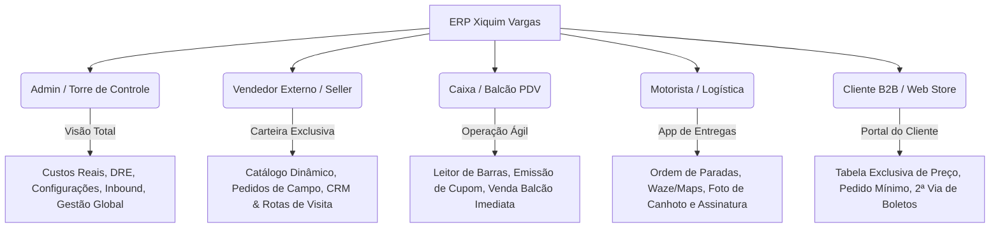
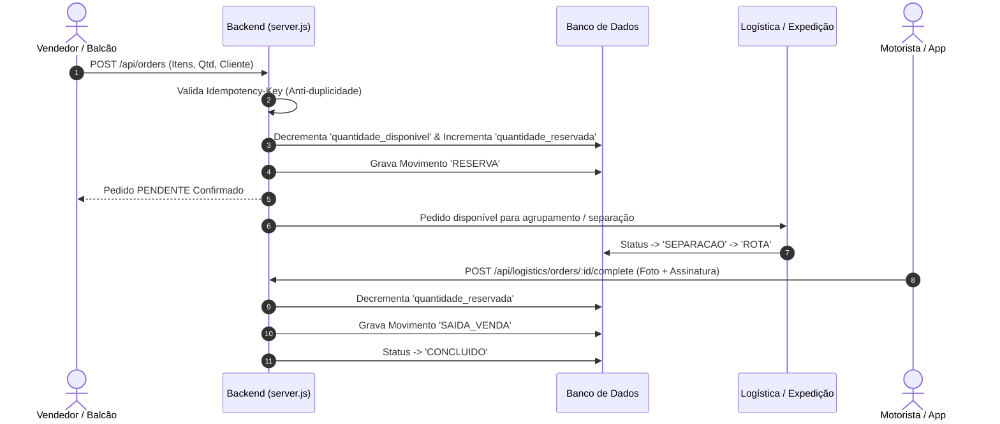

# 📋 Dossiê Executivo de Capacidades Comerciais e Operacionais
## ERP Xiquim Vargas v1.8.2 — Omnichannel, Logística & Rentabilidade Real

---

## 1. Visão Geral da Solução

O **ERP Xiquim Vargas** é uma plataforma corporativa integrada de gestão comercial, logística, controle de estoque e apuração de rentabilidade real, projetada especificamente para **distribuidoras, atacadistas, indústrias e operações de pronta-entrega**.

A plataforma resolve a fragmentação comum em empresas de distribuição, integrando no mesmo ecossistema:
- **Vendas Multicanal (Omnichannel)**: Balcão PDV, Vendedores Externos em campo (Mobile APK) e Loja B2B Online (Web Portal).
- **Inteligência de Formação de Preço**: Tabelas segmentadas por cliente, canal e promoções escalonadas por volume.
- **Controle Físico e Fiscal de Estoque**: Reserva atômica de saldo e cálculo automático de CMV (Custo Médio Ponderado).
- **Logística Integrada de Última Milha (Last-Mile)**: Agrupamento geográfico de pedidos, roteirização com otimização TSP (Traveling Salesperson Problem) e comprovação digital de entrega (POD - Proof of Delivery).
- **Fechamento e Lucro Real**: Apuração de margem líquida por pedido, vendedor e produto, deduzindo custos de aquisição e frete.

---

## 2. Matriz de Perfis e Segurança Operacional (Role-Based Access Control)

O sistema conta com um motor de autorização baseado em tokens seguros JWT, garantindo que cada colaborador acesse apenas as informações necessárias à sua função:

### Detalhamento dos Níveis de Acesso

| Perfil (`role`) | Interface / Aplicação | Escopo de Acesso e Regras de Negócio |
| :--- | :--- | :--- |
| **`admin`** *(Torre de Controle)* | Web Desktop & Mobile Tower APK | **Irrestrito**. Acesso a custos de compra dos fornecedores, DRE gerencial, margem de contribuição, parametrização de tabelas de preço, criação de usuários, auditoria completa (`audit_logs`) e expedição logística. |
| **`seller`** *(Venda Externa)* | Web Responsivo & Mobile Seller APK | **Blindagem de Carteira**. Enxerga exclusivamente os clientes vinculados ao seu ID ou clientes sem vendedor atribuído. Cria clientes com captura automática para sua carteira. Não visualiza custos de fornecedor nem margem bruta da distribuidora. |
| **`cashier`** *(Operador de Balcão)* | Web PDV & Mobile Cashier APK | **Agilidade de Balcão**. Focado em atendimento rápido de balcão e retiradas no local. Emissão com leitor de código de barras, busca ultrarrápida de itens e impressão de cupom não-fiscal. Pedidos nascem com origem `BALCAO`. |
| **`driver`** *(Motorista / Frota)* | Web Motorista & Mobile Driver APK | **Execução de Rota**. Enxerga apenas as viagens e romaneios atribuídos ao seu veículo. Ordenação inteligente de entrega com integração a navegadores GPS, coleta de assinatura touch e captura de foto do comprovante. |
| **`web_client`** *(Cliente B2B)* | Portal Web B2B | **Autoatendimento B2B**. Acesso restrito aos dados do próprio CNPJ via `usuario_clientes`. Enxerga os preços de sua tabela contratual e promoções vigentes, com validação de pedido mínimo configurado pela distribuidora. |

---

## 3. Capacidades Comerciais

### 3.1. Motor de Precificação Dinâmica Hierárquica (`priceFor`)
O ERP possui um motor inteligente de cálculo de preços que decide o valor do item em tempo real conforme a seguinte hierarquia:
1. **Tabela de Preço do Cliente**: Preços negociados por contrato vinculados ao cliente ou à categoria do cliente, incluindo faixas de desconto por volume (ex: 1 a 10 caixas R$ 50,00; acima de 11 caixas R$ 46,00).
2. **Promoções Ativas**: Campanhas sazonais com datas de vigência, limites de quantidade por cliente e regras de acúmulo.
3. **Preço Base**: Preço de tabela padrão cadastrado no item.
4. **Segmentação por Canal**: Tabelas específicas atribuíveis a canais (`TODOS`, `WEB`, `BALCAO` ou `VENDEDOR`), permitindo políticas comerciais distintas entre vendas no balcão e vendas em campo.

### 3.2. Gestão de Carteira e CRM de Vendas Externas
- **Carteira Blindada**: Previne conflito entre representantes comerciais da mesma empresa.
- **Matriz RFM Automatizada**: Segmenta clientes automaticamente em:
  - **VIP**: Alto ticket e alta frequência.
  - **ATIVO**: Compraram nos últimos 30 dias.
  - **EM RISCO**: Sem compras entre 31 e 60 dias (gatilho de recuperação de vendas).
  - **INATIVO**: Sem compras há mais de 60 dias.
  - **NOVO**: Menos de 30 dias de cadastro.
- **Roteiro Periódico de Visitas**: Mapeamento da agenda semanal do vendedor (segunda a sábado) para otimização de visitas físicas e contatos via WhatsApp.
- **Histórico de Interações**: Registro auditável de propostas comerciais enviadas, contatos realizados, objeções e motivos de não compra.

### 3.3. PDV / Venda Balcão de Alta Velocidade
- Leitura direta via barcode scanner com processamento em microssegundos (`/api/pdv/barcode`).
- Modo `CLIENTE-BALCAO` para vendas sem necessidade de pré-cadastro burocrático de CPF/CNPJ.
- Modalidade de entrega padrão `RETIRADA`, liberando estoque de forma imediata.

---

## 4. Capacidades Operacionais e de Estoque

### 4.1. Reserva Atômica e Prevenção de "Furo de Estoque"
- **Reserva Imediata no Pedido (`PENDENTE`)**: No exato momento em que um pedido é gerado (seja por um vendedor no interior via 4G, seja na loja online B2B, seja no caixa), o saldo disponível é imediatamente bloqueado:
  $$\text{Disponível} = \text{Físico} - \text{Reservado}$$
- **Estorno Automático em Cancelamentos**: Se um pedido for cancelado nas fases de separação ou pendente, a reserva é devolvida instantaneamente ao estoque disponível com log de auditoria `CANCELAMENTO_PEDIDO`.
- **Baixa Definitiva Apenas na Entrega**: A mercadoria só sai do registro contábil de reserva e é baixada em definitivo (`SAIDA_VENDA`) quando há a efetiva confirmação da entrega.

### 4.2. Inbound e Custo Médio Ponderado (CMV)
- **Módulo de Fornecedores e Compras**: Registro de pedidos de compra, prazos de entrega, condições comerciais e representantes.
- **Entrada de Mercadoria**: Atualização automática do estoque físico com cálculo imediato do Custo Médio Ponderado:
  $$\text{Novo Custo Médio} = \frac{(\text{Qtd Atual} \times \text{Custo Atual}) + (\text{Qtd Nova} \times \text{Custo Entrada})}{\text{Qtd Total}}$$
- Esse custo médio é a base mandatória que alimenta o módulo de apuração de rentabilidade real.

---

## 5. Capacidades Logísticas e Last-Mile

### 5.1. Agrupamento Inteligente por Bairro e Região
A expedição visualiza os pedidos prontos para entrega agrupados por bairros ou setores de entrega (`/api/logistics/grouped-orders`), permitindo lotação eficiente dos veículos da frota.

### 5.2. Otimização de Paradas via Algoritmo TSP
O ERP implementa cálculo de rotas usando a matriz de distâncias (Haversine e integração com mapas). Ao despachar uma rota para o motorista, as entregas são automaticamente ordenadas para percorrer a **menor distância em menor tempo**, reduzindo custo de combustível e desgaste de frota.

### 5.3. Comprovação Digital de Entrega (Proof of Delivery - POD)
No smartphone do motorista:
- **Assinatura Digital**: Coleta da rubrica do recebedor na tela de toque do celular.
- **Captura Fotográfica**: Upload de foto nítida do canhoto assinado ou da mercadoria descarregada no cliente.
- **Tratamento de Ocorrências e Devoluções (`/api/logistics/orders/:id/fail`)**: Caso o cliente esteja fechado ou recuse itens, o motorista registra a falha com motivo categorizado, retornando a mercadoria para a conferência da expedição.

---

## 6. Inteligência Financeira e Lucro Real

Diferente de sistemas que registram apenas faturamento bruto, o ERP Xiquim Vargas apura a margem líquida real de cada transação:

$$\text{Lucro Real} = \text{Receita Líquida Faturada} - \text{Custo Médio das Mercadorias (CMV)} - \text{Custos de Logística/Frete}$$

### Painéis Gerenciais Disponíveis para a Diretoria (`admin`):
- **Rentabilidade por Vendedor**: Permite avaliar com clareza quais representantes vendem com maior margem e quais dão descontos excessivos.
- **Rentabilidade por Produto / Categoria**: Identifica os produtos "estrelas" (alta margem e alto volume) e itens que geram prejuízo operacional.
- **Controle de Inadimplência e Formas de Pagamento**: Visão clara de valores a receber divididos por dinheiro, PIX, boleto e cartão de crédito.

---

## 7. Arquitetura Tecnológica e Distribuição

- **Backend**: Node.js com motor transacional SQLite de alta concorrência (WAL Mode - Write-Ahead Logging) e validação de concorrência com chaves de idempotência.
- **Frontend Core**: SPA em Vanilla JS moderno e CSS customizado, com identidade visual padronizada (Navy Blue `#061a4f` e Laranja `#fd5e02`), garantindo altíssima velocidade e zero dependência de frameworks pesados no cliente.
- **Aplicativos Nativos Multi-Plataforma**:
  - `tower-native` (Admin / Gestor)
  - `seller-native` (Vendedor de Campo)
  - `cashier-native` (Operador de Balcão)
  - `driver-native` (Motorista de Entrega)
- **Sincronização de Ativos**: Script PowerShell integrado (`scripts/sync-mobile-assets.ps1`) que compila e distribui automaticamente qualquer evolução visual ou funcional para todos os APKs de distribuição.

---

## 8. Conclusão

O **ERP Xiquim Vargas v1.8.2** consolida-se como uma solução robusta de classe empresarial. Ele elimina perdas operacionais por furos de estoque, impede desvios de carteira entre vendedores, otimiza os custos logísticos de entrega e fornece à diretoria a visão exata do **lucro líquido real no bolso**, tornando a distribuidora altamente competitiva, ágil e escalável.
