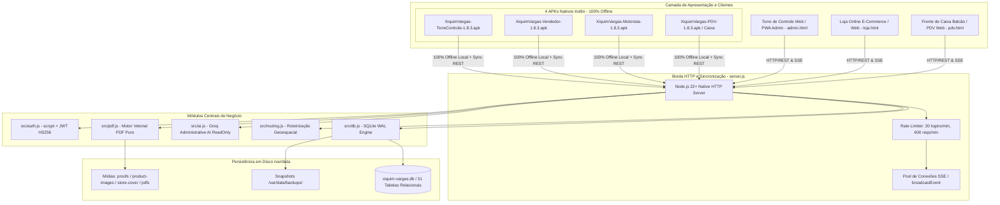
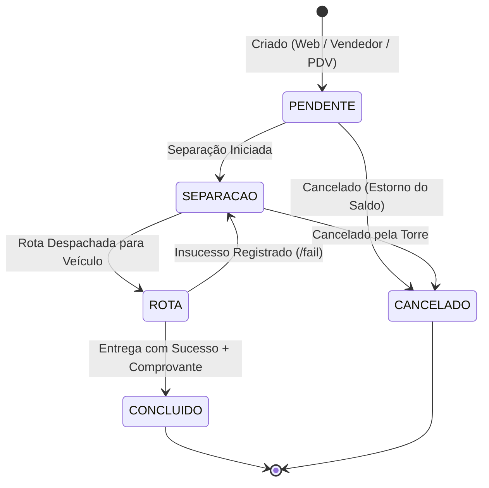

# RAIO-X DE ENGENHARIA COMPLETO — ERP AUTONOMIA (XIQUIM VARGAS)
**Arquitetura Profunda, Dicionário de Dados das 31 Tabelas, Máquinas de Estado e Invariantes**  
**Versão do Sistema:** 2.2.1 / 1.8.2 Delivery Hardened | **APKs Nativos:** v1.8.3 (100% Offline)  
**Ambiente Oficial:** https://xiquim-vargas-erp.onrender.com | **Data:** Outubro de 2026

---

## 1. TOPOLOGIA DE SISTEMAS E ARQUITETURA DE CLIENTES

---

## 2. DICIONÁRIO DE DADOS DAS 31 TABELAS RELACIONAIS (SQLITE WAL)
O banco de dados transacional conta com 31 tabelas normalizadas e protegidas por chaves estrangeiras ativas (`PRAGMA foreign_keys = ON`):

1. **`usuarios`**: Contas de operadores (`id, nome, email, senha_hash, role, ativo, telefone, created_at`).
2. **`categorias`**: Famílias de produtos (`id, nome, descricao, ativo, created_at`).
3. **`subcategorias`**: Subdivisões vinculadas a categorias (`id, categoria_id, nome, descricao, ativo`).
4. **`produtos`**: Catálogo mestre (`id, nome, sku, codigo_barras, marca, sabor, tamanho, unidade, preco_base, preco_custo, categoria_id, subcategoria_id, ativo, esgotado, foto_url, created_at, updated_at`).
5. **`estoque`**: Saldos centrais (`produto_id, quantidade_disponivel, quantidade_reservada, estoque_minimo, updated_at`).
6. **`movimentacoes_estoque`**: Ledger auditado (`id, produto_id, tipo, quantidade, quantidade_anterior, quantidade_posterior, operador_id, observacao, created_at`).
7. **`tabelas_preco`**: Políticas comerciais (`id, nome, descricao, percentual_ajuste, ativo, created_at, updated_at`).
8. **`tabela_preco_itens`**: Preços específicos por SKU (`id, tabela_id, produto_id, preco, quantidade_minima`).
9. **`clientes`**: Cadastro de clientes B2B/B2C (`id, razao_social, nome_fantasia, cnpj_cpf, endereco, bairro, cidade, telefone, email, vendedor_id, tabela_preco_id, ativo, created_at, updated_at`).
10. **`usuario_clientes`**: Vínculo entre credencial online e cadastro comercial.
11. **`cliente_interacoes`**: Histórico de atendimentos do CRM (`id, cliente_id, usuario_id, tipo, resumo, detalhes, created_at`).
12. **`pedidos`**: Ordens de venda (`id, numero, cliente_id, operador_id, origem, status, subtotal_bruto, desconto_tipo, desconto_valor, total, observacoes, forma_pagamento, pagamento_status, valor_recebido, troco, cartao_modalidade, parcelas, modalidade_entrega, pdf_path, pdf_status, cancelled_at, cancelled_by, motivo_cancelamento, created_at, updated_at`).
13. **`pedido_itens`**: Linhas do pedido (`id, pedido_id, produto_id, quantidade, preco_unitario_aplicado, subtotal, custo_unitario_aplicado`).
14. **`pedido_retornos`**: Log de ocorrências e devoluções (`id, pedido_id, rota_id, motorista_id, motivo, descricao, created_at`).
15. **`rotas_logistica`**: Rotas diárias despachadas (`id, data, motorista_id, veiculo_placa, status, sequencia_json, created_at, updated_at`).
16. **`rota_pedidos`**: Vínculo entre pedido e rota de transporte (`rota_id, pedido_id`).
17. **`comprovantes_entrega`**: Registro de fotos de canhoto/assinatura (`id, pedido_id, motorista_id, arquivo_path, created_at`).
18. **`rotas_config`**: Cronograma padrão semanal (`id, nome, dia_semana, descricao, ativo`).
19. **`rota_bairros`**: Mapeamento de bairros atendidos pela rota (`rota_config_id, bairro`).
20. **`vendedor_rotas`**: Escala de vendedores por rota semanal (`vendedor_id, rota_config_id, dia_semana`).
21. **`fornecedores`**: Fornecedores de suprimentos (`id, razao_social, nome_fantasia, cnpj, telefone, email, contato, endereco, ativo, created_at`).
22. **`fornecedor_produtos`**: Itens fornecidos por parceiro (`id, fornecedor_id, produto_id, codigo_fornecedor, preco_custo, prazo_dias`).
23. **`compras`**: Ordens de compra de mercadorias (`id, numero, fornecedor_id, usuario_id, status, total, observacoes, created_at, updated_at`).
24. **`compra_itens`**: Linhas da ordem de compra (`id, compra_id, produto_id, quantidade, preco_custo_unitario, subtotal`).
25. **`produto_custos_historico`**: Rastreabilidade de custo médio (`id, produto_id, custo, tipo_ajuste, origem_id, motivo, data_inicio, data_fim, usuario_id`).
26. **`produto_imagens`**: Fotos adicionais do catálogo (`id, produto_id, arquivo_path, mime_type, tamanho_bytes, principal, ordem, created_at`).
27. **`promocoes`**: Campanhas promocionais temporárias (`id, produto_id, nome, preco_promocional, inicio, termino, ativo, created_at`).
28. **`configuracoes`**: Chaves operacionais (`chave, valor, updated_at`).
29. **`audit_logs`**: Trilhas de auditoria administrativa (`id, usuario_id, acao, entidade, entidade_id, antes_json, depois_json, metadata_json, created_at`).
30. **`idempotency_keys`**: Prevenção de duplicidades (`id, user_id, route, key_value, response_status, response_json, created_at`).
31. **`system_events`**: Telemetria interna e requisições (`id, level, event, request_id, message, metadata_json, created_at`).

---

## 3. MÁQUINAS DE ESTADO E INVARIANTES TRANSACIONAIS

### 3.1 Ciclo do Pedido

### 3.2 Invariantes de Engenharia Atendidos
* **Zero Negative Stock:** O update de reserva de estoque (`UPDATE estoque SET quantidade_disponivel = quantidade_disponivel - ? WHERE ... AND quantidade_disponivel >= ?`) valida atomicamente o saldo no momento da inserção.
* **Cálculo Monetário Inteiro:** Totais e subtotais são convertidos para centavos (`Math.round(preco * 100) * quantidade`) antes de operações aritméticas e divisões finais.
* **Fallback Instantâneo dos APKs:** Interceptação nativa de requisições web locais (`shouldInterceptRequest`) garantindo abertura em ~0.05s em modo avião.
