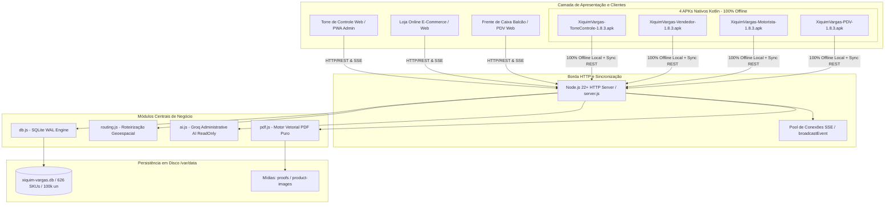

# RAIO-X DE ENGENHARIA COMPLETO — ERP AUTONOMIA (XIQUIM VARGAS)
**Versão do Sistema:** 2.2.1 / 1.8.2 Delivery Hardened | **APKs Nativos:** v1.8.3 (100% Offline)  
**Ambiente Oficial:** https://xiquim-vargas-erp.onrender.com | **Data:** Outubro de 2026

---

## 1. TOPOLOGIA DE SISTEMAS E ARQUITETURA DE CLIENTES

### 1.1 Invariantes de Engenharia Atendidos
* **Abertura 100% Offline dos APKs:** Implementação de `shouldInterceptRequest` servindo arquivos embutidos de `assets/www/` em ~0.05s sem requerer conectividade.
* **URL Oficial Fixa:** `https://xiquim-vargas-erp.onrender.com` pré-configurada nos APKs e no servidor.
* **Ícone Oficial HD:** `01_Logo_Xiquim_Vargas_HD.png` aplicado nos 4 apps nativos.
* **Base de Inauguração:** 626 SKUs ativos, 100.000 unidades em estoque por produto, zero pedidos fictícios de teste.
* **Identidade Visual Vendedor:** Subtítulos no tom institucional Laranja (`#FD5E02`) e cache PWA v1.8.12.
