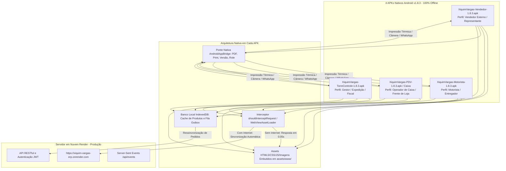

# AUTONOMIA SYSTEMS — MANUAL COMPLETO DA SUÍTE DE APLICATIVOS ANDROID NATIVOS (100% OFFLINE)
**Guia Oficial de Instalação, Arquitetura Kotlin, Operação Offline e Distribuição dos 4 APKs**  
**Versão da Release:** 2.2.1 / 1.8.2 Delivery Hardened | **Versão dos APKs:** v1.8.3 (Build 5)  
**Ambiente Oficial de Produção:** https://xiquim-vargas-erp.onrender.com | **Data:** Outubro de 2026

---

## 1. APRESENTAÇÃO DA SUÍTE MOBILE NATIVA
A operação comercial, logística e de frente de caixa do **Xiquim Vargas** é potencializada por uma suíte dedicada de **4 Aplicativos Nativos para o sistema operacional Android**. 

Cada aplicativo foi especialmente projetado e customizado para o fluxo de trabalho de cada função na empresa, eliminando telas desnecessárias e garantindo **alta velocidade de trabalho, confiabilidade extrema e funcionamento 100% offline**:



---

## 2. INVENTÁRIO COMPLETO DOS ARQUIVOS APK
Todos os aplicativos encontram-se compilados, assinados e prontos para distribuição direta na pasta `/dist-apks/` (bem como em `/mobile/apks/`, `/apks versao final/` e na raiz do projeto):

| Arquivo APK | Pacote (Application ID) | Label / Ícone | Tela Inicial Padrão | Tamanho Aprox. |
| :--- | :--- | :--- | :--- | :---: |
| **XiquimVargas-Vendedor-1.8.3.apk** | `br.com.xiquimvargas.seller` | Vendedor | `/vendedor.html` | ~28 MB |
| **XiquimVargas-Motorista-1.8.3.apk** | `br.com.xiquimvargas.driver` | Motorista | `/motorista.html` | ~28 MB |
| **XiquimVargas-PDV-1.8.3.apk** *(Caixa)*| `br.com.xiquimvargas.pdv` | Caixa | `/pdv.html` | ~28 MB |
| **XiquimVargas-TorreControle-1.8.3.apk** | `br.com.xiquimvargas.tower` | Torre de Controle | `/admin.html` | ~28 MB |

*Nota sobre tamanho:* O tamanho de aproximadamente 28 MB de cada arquivo decorre da inclusão de todos os recursos de interface gráfica, fontes institucionais e logos em altíssima definição (`01_Logo_Xiquim_Vargas_HD.png`, etc.) dentro do arquivo binário, garantindo autonomia completa de exibição sem requerer downloads posteriores pela internet.

---

## 3. GUIA PASSO A PASSO DE INSTALAÇÃO NO DISPOSITIVO ANDROID
A instalação nos smartphones e tablets corporativos da equipe é realizada de forma direta (sideloading sem dependência da Google Play Store):

### 3.1 Preparação do Dispositivo:
1. Conecte o smartphone Android ao computador via cabo USB, ou acerte o envio dos arquivos APK por WhatsApp Web, Google Drive ou servidor local.
2. Acesse as **Configurações** do Android:
   * Vá em **Segurança** (ou **Privacidade e Segurança**).
   * Localize a opção **"Instalar aplicativos de fontes desconhecidas"** (ou **"Fontes Desconhecidas"**).
   * Marque permissão para o navegador ou gerenciador de arquivos que você usará para abrir o APK.

### 3.2 Execução da Instalação:
1. Abra o arquivo do APK correspondente à função do colaborador (exemplo: `XiquimVargas-Vendedor-1.8.3.apk` para o vendedor).
2. O instalador do pacote do Android solicitará a confirmação: clique em **"Instalar"**.
3. Ao finalizar, clique em **"Abrir"**.
4. O aplicativo solicitará permissões operacionais necessárias:
   * **Câmera:** para o motorista fotografar comprovantes de entrega e canhoto assinado.
   * **Localização:** para apoio à roteirização e cálculo viário.
   * **Rede / Internet:** para comunicação com a nuvem quando houver conexão.
   Clique em **"Permitir durante o uso do app"** em todas.

### 3.3 Acesso Instantâneo e Zero Configuração:
* O aplicativo abre **no mesmo segundo** exibindo a interface oficial do Xiquim Vargas.
* **O colaborador NÃO precisa configurar nada:** a URL oficial de produção (`https://xiquim-vargas-erp.onrender.com`) já está pré-gravada no código do aplicativo.
* Se o colaborador estiver sem sinal (na estrada, galpão fechado ou áreas rurais), o aplicativo abre da mesma forma, sem travar nem exibir telas de erro.

---

## 4. COMO FUNCIONA A ABERTURA 100% OFFLINE
Tradicionalmente, aplicativos que utilizam WebView tentam carregar a página pela rede. Se não houver internet, o Android exibe uma tela branca feia com o erro `ERR_NAME_NOT_RESOLVED` ou `ERR_INTERNET_DISCONNECTED`.

A engenharia da AutonomIA Systems implementou uma arquitetura diferenciada no `MainActivity.kt`:
1. **Assets Locais Empacotados:** Todos os arquivos (`styles.css`, `app.js`, `role.js`, `vendedor.html`, `motorista.html`, etc.) foram gravados na pasta interna `app/src/main/assets/www/` dentro do APK durante a compilação.
2. **Interceptação Nativa de Requisições:** O método `shouldInterceptRequest` intercepta as requisições destinadas ao domínio do ERP:
   - Se for um arquivo estático (HTML, CSS, JavaScript, imagem ou fonte), o aplicativo entrega o arquivo **diretamente da memória flash do aparelho**.
   - Esse carregamento ocorre na velocidade da memória local (~0.05 segundos).
3. **Desativação de Telas de Bloqueio:** O código legado `showOfflineScreen()` foi desativado para garantir que o colaborador tenha acesso instantâneo à interface sem interrupções.
4. **Fila Outbox em IndexedDB:** Quando o operador realiza ações (lançar pedido, registrar baixa), os dados são salvos no banco local IndexedDB do navegador interno (`xv-offline-v1-...`). Assim que a conexão de dados retornar, a função nativa `syncOfflineQueue()` despacha as requisições pendentes de forma silenciosa para o servidor na nuvem.

---

## 5. GUIA OPERACIONAL POR APLICATIVO

### 5.1 App Vendedor (`XiquimVargas-Vendedor-1.8.3.apk`)
* **Catálogo de 620 Produtos:** Exibição ágil com imagens oficiais, códigos SKU, embalagens e preços.
* **Tabelas de Preço Dinâmicas:** Ao selecionar um cliente, o aplicativo calcula automaticamente os preços diferenciados e descontos por quantidade da tabela vinculada.
* **Emissão de Pedidos no Cliente:** O vendedor monta o carrinho de compras. Ao clicar em **"Finalizar Pedido"**, se estiver sem internet, o pedido é armazenado com segurança no celular com o status de fila pendente.
* **Identidade Visual:** Textos operacionais e subtítulos no tom institucional Laranja (`#FD5E02`) e tipografia 700.

### 5.2 App Motorista (`XiquimVargas-Motorista-1.8.3.apk`)
* **Listagem da Rota do Dia:** O motorista abre o app e vê os pedidos ordenados por bairro e prioridade viária.
* **Ação Direta de Comunicação:** Dois botões dedicados ao lado de cada parada:
  - Botão **WhatsApp:** abre diretamente a conversa com o cliente no WhatsApp do celular, com mensagem pré-formatada.
  - Botão **Ligar:** abre o discador do celular com o telefone do cliente preenchido.
* **Comprovante de Entrega:** O motorista toca em **"Fotografar Comprovante"**, a câmera do aparelho abre para captura do canhoto assinado ou mercadoria entregue. Ao confirmar, o pedido é concluído.
* **Registro de Insucesso / Retorno:** Caso o cliente não esteja ou o local esteja fechado, o motorista toca em **"Registrar Retorno"**, escolhe o motivo (ex: "Cliente Ausente") e confirma. O pedido reverte automaticamente para separação na Torre.

### 5.3 App Caixa e PDV (`XiquimVargas-PDV-1.8.3.apk` / `XiquimVargas-Caixa-1.8.3.apk`)
* **Bipagem Contínua:** Compatível com leitores de código de barras USB ou Bluetooth, bem como digitação rápida de SKU.
* **Cliente Balcão Padrão:** Pré-seleciona `CLIENTE-BALCAO` para atendimento express.
* **Múltiplos Meios de Pagamento:** Recebimento em Dinheiro (com cálculo automático de troco em tela), Cartão de Débito, Crédito (à vista ou parcelado de 2x a 12x) e PIX.
* **Impressão Térmica:** O comando de imprimir comprovante conecta-se via `AndroidApp.printWebPage()` ao serviço de impressão do Android, acionando mini-impressoras térmicas de 58mm ou 80mm.

### 5.4 App Torre de Controle (`XiquimVargas-TorreControle-1.8.3.apk`)
* **Painel Executivo Móvel:** Permite aos diretores e supervisores acompanhar o faturamento do dia, contadores em tempo real e gráficos de vendas.
* **Painel de Pedidos Retornados:** Exibe na hora qualquer insucesso reportado pelos motoristas, com motorista, cliente, bairro e motivo para contato imediato.
* **Liberação de Cargas e Separação:** Liberação de romaneios e pedidos diretamente do tablet ou smartphone.

---

## 6. MANUTENÇÃO, COMPILAÇÃO E PIPELINE DE CI/CD

### 6.1 Compilação Local de Todos os APKs:
Para gerar novas versões dos 4 aplicativos na estação de desenvolvimento:
```powershell
# Executar a esteira automatizada no PowerShell:
powershell -NoProfile -ExecutionPolicy Bypass -File scripts\build-all-apks.ps1
```
Este script executa três etapas ordenadas:
1. `scripts/sync-mobile-assets.ps1`: Sincroniza os arquivos de `public/` (`styles.css`, `app.js`, `role.js`, `*.html` e fotos institucionais) para a pasta `assets/www/` de cada um dos 4 projetos nativos.
2. `gradlew assembleDebug`: Compila os 4 projetos em Gradle 9.6.0 com Java 17 LTS.
3. `scripts/update-dist-apks.ps1`: Copia e distribui os APKs compilados para `/dist-apks/`, `/mobile/apks/`, `/apks versao final/` e para a raiz.

### 6.2 Pipeline na Nuvem (GitHub Actions):
O repositório possui o fluxo `.github/workflows/android.yml` configurado. A cada atualização no diretório `mobile/**`, a nuvem compila os 4 APKs em ambiente Ubuntu limpo e disponibiliza o artefato compactado para download imediato.

---

## 7. RESOLUÇÃO DE PROBLEMAS E DÚVIDAS FREQUENTES (FAQ)

**P: O que fazer se o aplicativo abrir em tela de configuração pedindo URL?**  
R: Isso só acontece se o app for limpo ou se o arquivo de configuração interna for alterado. Basta tocar no botão "Conectar e Acessar" — o endereço oficial (`https://xiquim-vargas-erp.onrender.com`) já vem pré-preenchido.

**P: Os pedidos feitos sem internet correm risco de se perder?**  
R: Não. Eles ficam salvos no banco local de alta durabilidade do smartphone (IndexedDB). Assim que o sinal de internet for detectado, o próprio app envia os pedidos em segundo plano.

**P: É possível alterar a URL de produção para um servidor de testes?**  
R: Sim. No código de `MainActivity.kt`, há a tela de configuração acessível ao limpar os dados do app ou via `configScreen()`, onde é possível digitar um novo endereço HTTPS ou IP de rede local.

**P: Como imprimir comprovantes em impressoras térmicas portáteis Bluetooth?**  
R: Instale o aplicativo de serviço de impressão da impressora (ex: RawBT, ESC/POS Service ou serviço oficial da fabricante) no Android. Ao clicar em "Imprimir" no app PDV/Caixa, selecione a impressora na tela padrão do sistema.
